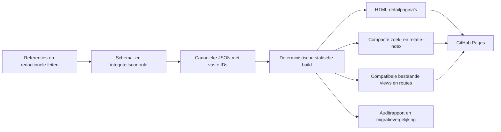

# The Kingverse 1.6 — architectuur en The Connected Kingverse

Status: foundation fase 1 geïmplementeerd in een aparte v2-dataset; latere Explorer-/runtimefasen blijven ontwerp. Peildatum: 25 oktober 2026. Onderzochte applicatiebasis: commit `ca5f336f72ad6c41a28e30d3ac79a4667b5c9032` (1.5.1). De actieve website en catalogus blijven op de bestaande 1.5.1-runtime. De foundation voegt offline data, schema, register, validator en compatibiliteitsadapter toe zonder die runtime om te schakelen.

## 1. Besluiten

Behoud GitHub Pages, HTML, CSS en JavaScript. Normaliseer de redactionele brondata in gewone JSON-bestanden, valideer die tijdens de build en genereer daaruit compacte zoekgegevens, statische detailpagina’s en compatibele bestaande catalogusweergaven. Introduceer geen framework, database, graphserver, accountdienst of runtime-API voor de basisencyclopedie. Het netwerk van relaties is een geïndexeerde verzameling getypeerde verbindingen; een interactieve grafiek is een latere weergave daarvan.

Engels blijft de eerste ontwikkeltaal en de standaard voor nieuwe bezoekers. Behoud Nederlandse titels, edities, opgeslagen taalvoorkeur en bestaande fallbackregels. Verdere Nederlandse uitwerking en nieuwe beeldresearch blijven uitgesteld. Het ontwerp ondersteunt die gegevens wel.

StephenKing.com is de primaire bibliografische standaard. **IMDb** is de historische aanvullende bron van vier bestaande screen-records; hergebruik is nog niet aangetoond. Geen betaalde IMDb-API of abonnementen. Een eventuele kosteloze aanvullende bron wordt pas gekozen na toetsing van de toepasselijke voorwaarden. Op expliciete verduidelijking van de gebruiker wordt geen OMDb-integratie ontworpen. Productie-, distributeurs- en streamingbronnen blijven leidend voor credits en actuele adaptatiestatus.

De eerste implementatie is de beperkte migratieproef met The Talisman en Black House. De bestaande website blijft leidend; de interactieve Explorer is de volgende afzonderlijke ontwikkelfase.

## 2. Analyse van de huidige applicatie

### 2.1 Wat na 1.4 is verbeterd

| Basis | Aantoonbare verandering |
| --- | --- |
| `5e202ea` / 1.4 | HTML, presentatie, runtime en catalogus gesplitst; taalgebonden covers en remake-specifieke posters toegevoegd. |
| `cc4979d` / 1.5 | Officiële inventarisatie, werk-/editie-identiteiten, bundelrelaties, auteursrollen, samenwerkingenfilter, bronrapporten, Engelse standaard, hash-navigatie en Sources & Method-pagina. |
| `ca5f336` / 1.5.1 | Vier aanvullende screen-records per veld gecontroleerd; IMDb-verwijzingen, korte beschrijvingen, drie opgeslagen scores en één expliciet onbevestigde score. |

De huidige scheiding is bruikbaar: `index.html` en `about.html` vormen de pagina’s, `styles.css` de presentatie, `app.js` de runtime, `catalog.js` en `media.js` de gegenereerde data. `scripts/build_catalog.py` en `scripts/report_quality.py` maken die bestanden uit referentiesnapshots en redactionele correcties. De ongewijzigde 1.4-import en toenmalige weergavedata blijven apart bewaard. Normaal bezoek vereist geen build of installatie; redactionele wijzigingen hebben wel een offline generatieproces.

### 2.2 Omvang en betrouwbaarheid

Volgens de gecontroleerde lokale bestanden `data/quality-summary.json` en `data/audit.json`:

| Groep | Huidige omvang | Betekenis en beperking |
| --- | ---: | --- |
| Bibliotheek | 86 | Romans, bundels, novellen en enkele andere samenwerkingsprojecten; geen 86 unieke romans. |
| Verhalenweergave | 173 | Unieke verhaal-/bundelbijdragen, inclusief enkele gedichten, essay- en scenariobijdragen. |
| `works` | 256 | Gedeelde literaire identiteiten, inclusief 15 met `kind: collection`; bibliotheek/verhalen zijn deels overlappende weergaven. |
| `editions` | 154 | Editievoorbeelden, grotendeels ontstaan uit beeldkandidaten; niet alle historische uitgaven. |
| Adaptaties | 96 | 90 primaire bronentiteiten plus zes aanvullingen; geen uitputtende inventaris van korte films, afleveringen en franchise-uitbreidingen. |
| Tower-connecties | 17 | Toelichting, bron en zekerheidsniveau; concepten/personages/plaatsen zijn nog tekstlabels. |
| Samenwerkingen | 13 | Alle 11 regels van de officiële samenwerkingsindex vergeleken, plus aanvullingen; niet elk project is gezamenlijk geschreven fictie. |

De inventarisatiescope is volledig op aanwezigheid vergeleken, maar 85 bibliotheekrecords, 173 verhaalrecords en 92 adaptatierecords hebben minstens één open auditveld. Bij 29 adaptaties staat de bronrelatie nog open, ook wanneer een kandidaat-werkkoppeling al bestaat. Een resolvabele link bewijst dus geen geverifieerde adaptatierelatie. Eerste-publicatiegeschiedenis is vrijwel overal nog een afzonderlijke onderzoekstaak. Brooks is slechts via uitgevers-/bibliotheekmetadata geraadpleegd. Die grenzen uit `DATA-QUALITY.md` blijven leidend.

Er zijn 61 NL- en 86 EN-boek/bundelcovers en 82 posters geregistreerd. 145 bijdragen gebruiken terecht een bundelcover. Deze aantallen zijn geen doel voor nieuwe beeldresearch in deze fase.

### 2.3 Architectuurproblemen, op prioriteit

1. **De weergavedata is nog het feitelijke domeinmodel.** `books`, `stories` en `films` bevatten herhaalde titels, namen en metadata. Het compacte `works`-overzicht wordt daaruit achteraf afgeleid en bezit niet alle feiten. Nieuwe relaties moeten rechtstreeks naar canonieke entiteiten kunnen wijzen.
2. **Identiteiten worden opnieuw berekend uit veranderlijke waarden.** Werk-IDs volgen titel-slugs, film-IDs titel/jaar, editie-IDs ISBN of een hash met bron-URL. Correcties kunnen IDs en deeplinks veranderen. Bewaar bestaande IDs en leg nieuwe IDs éénmaal vast in een register.
3. **Relaties verwijzen deels naar een weergave of titel.** `collectionIds` verwijzen naar `books:*`; `sourceWorks` naar boek-/verhaalweergaven. Bundelrelaties en sommige bronkoppelingen worden via genormaliseerde titels teruggevonden. Dat schaalt slecht bij gelijknamige verhalen, bundels en remakes.
4. **Edities zijn te sterk aan afbeeldingen gekoppeld.** Een werk zonder coverkandidaat kan onvoldoende editiegegevens hebben. Een afbeelding op een werkpagina met onbekend ISBN wordt als editievoorbeeld bewaard, maar identificeert niet vanzelf de eerste druk. ISBN, editie en beeldgoedkeuring moeten afzonderlijk te controleren zijn.
5. **Bronadministratie is versnipperd.** `Bron`, `sources`, `audit.fields`, lokale snapshots en aparte overrides gebruiken verschillende structuren. Eén `checked`-datum maakt niet ieder veld actueel. Auditstatus, interpretatiezekerheid, toegang en datumsemantiek moeten los van elkaar worden opgeslagen.
6. **Mensen en fictieve entiteiten ontbreken als eigen gegevens.** Auteursrollen bestaan, maar dezelfde namen worden herhaald. Cast is vaak een tekstregel met acteur en personage samen. Personages, verschijningsvormen, locaties en cosmologische interpretaties zijn nog geen navigeerbare identiteiten.
7. **Runtime combineert meerdere verantwoordelijkheden.** `app.js` bevat zoeken, taal, routing, filtering, mediaselectie, HTML-opbouw en modalbeheer. De bestaande 26 Node-tests gebruiken een DOM-stub; ze vervangen geen echte browser-, toegankelijkheids- of performancetest.
8. **Alle catalogusdata wordt direct geladen.** Ongecomprimeerd zijn `catalog.js` 809.575 bytes en `media.js` 320.517 bytes: samen circa 1,13 MB. Auditdetails en dubbele feiten reizen mee naar iedere bezoeker. Zoeknormalisatie en `.find()`-relaties worden tijdens renderen herhaald. Meet werkelijke overdracht en verwerking voordat verdere optimalisatie nodig wordt verklaard.
9. **Persoonlijke gegevens hebben nog geen eigen grens.** Legacyvelden zoals `Status: Gelezen` staan in catalogusrecords. Dit is geen veilige basis om alle bezoekers een persoonlijke leesstatus toe te kennen. Bewaar herkomst tijdens migratie, maar scheid toekomstige persoonlijke lijsten van publieke bibliografische feiten.

Zoeken ondersteunt nu live invoer, knop en Enter via één actie, exacte titels, andere-taaltitels, auteurs en gekoppelde bundels. Filters werken per type/bundel en op samenwerkingen; sortering op jaar/titel. Vier hash-routes en details bewaren zoek/filter/sorteerstatus en ondersteunen terug/vooruit. EN/NL-tekst zit deels in runtimevertalingen en deels in records. Personagezoekwerk, samengestelde relatie-/bronfilters, spoilerbescherming en persoonlijke lijsten ontbreken. Deze bestaande functies zijn migratiecontracten.

### 2.4 IMDb: huidige werkelijkheid en gewenste grens

Een repositorybrede inspectie vindt geen OMDb-client, OMDb-key of OMDb-fetch. De vier `imdb`-objecten komen uit `data/reference/screen-1.5.1.json`. Carrie (2013), The Dead Zone (2002) en Haven hebben een score; Carrie (2002) heeft `null`. Het zijn waarnemingen uit geïndexeerde IMDb-resultaten, geen live API-resultaten. De Carrie-beschrijvingen gebruiken andere expliciet genoemde bronnen wegens ontoegankelijke IMDb-hoofdpagina’s.

**Eigenaarsbesluit foundation:** geen betaalde IMDb-API of abonnement, geen automatische scraper en geen OMDb-koppeling. De eerdere voorkeursroute via de officiële betaalde IMDb-dienst is vervallen.

De huidige data en herkomst zijn per veld geregistreerd in `data/reviews/screen-data-rights.json`. De drie scores komen uit geïndexeerde IMDb-webresultaten; de twee eigen beschrijvingen bij The Dead Zone en Haven zijn op IMDb-feiten gebaseerd. De Carrie-beschrijvingen zijn eigen redactionele teksten op basis van Apple TV/distributeurs- en productiefeiten. Geen live API, API-key, oorspronkelijke IMDb-synopsis of gebruikersreview is opgenomen. Een indexraadpleegdatum bewijst geen actuele score. De actieve dataset blijft in deze beperkte foundation intact, maar de IMDb-afgeleide velden staan expliciet op `needs-review`; er wordt geen toestemming verondersteld en er vindt geen uitbreiding plaats.

[IMDb beperkt website-extractie en herpublicatie](https://help.imdb.com/article/imdb/general-information/can-i-use-imdb-data-in-my-software/G5JTRESSHJBBHTGX). Ook gratis datasettoegang is geen algemene toestemming voor een publieke filmencyclopedie. Er is geen toestemmingsbewijs in deze repository aangetroffen. Dit is een vastgelegde hergebruiksonzekerheid, geen uitspraak dat iedere losse feitelijke vermelding onrechtmatig is. Vóór verdere publicatie-uitbreiding: toestemming onderbouwen of de betreffende score/IMDb-afgeleide tekst vervangen door een toegestane bron/eigen tekst en correcte leveranciersvermelding. IMDb-ID en externe link kunnen als verwijzing blijven bestaan zonder een onbevestigde score te kopiëren.

Kosteloos alternatief dat alleen is onderzocht, niet aangesloten: [TMDb developer API](https://developer.themoviedb.org/docs/faq) is volgens zijn documentatie kosteloos voor niet-commercieel gebruik onder attributievoorwaarden. Onder meer een goedgekeurd logo in About/Credits en de voorgeschreven niet-endorsementvermelding zijn nodig. De commerciële status van The Kingverse en de volledige toepasselijke voorwaarden moeten vóór gebruik zijn vastgesteld. Een TMDb-score krijgt label **TMDb**, eigen ID, bron, schaal, stemaantal waar bekend en waarnemingsdatum; nooit label IMDb. Er is geen TMDb-account/key aangemaakt, geen voorwaarden namens de eigenaar geaccepteerd en geen import uitgevoerd. Nieuwe afbeeldingen blijven uitgesteld.

De eenvoudigste toegestane basis blijft: eigen korte beschrijvingen uit gecontroleerde productiefeiten en een externe link voor ontbrekende beoordelingen. Een toekomstige kosteloze importadapter draait buiten de browser, publiceert alleen toegestane velden met attribution en houdt credentials buiten Git, frontend, logs en publicatieartefacten. Import staat los van de gewone offline build. Ontbrekende toegang, providerfouten of ingetrokken toestemming blokkeren de encyclopedie niet; toon een eerlijke ontbrekende-scorestatus. Het v2-schema weigert een numerieke geïmporteerde score zolang `reuseStatus` niet `allowed` is. De drie legacywaarnemingen worden dus niet als toegestane nieuwe v2-score geïmporteerd.

### 2.5 GitHub Pages

[GitHub Pages](https://docs.github.com/en/pages/getting-started-with-github-pages/what-is-github-pages) publiceert statische bestanden. Er is geen eigen serverproces voor geheime credentials, API-proxy, databasewrites of gebruikerssessies. Alle gepubliceerde JSON en JavaScript is openbaar. Een API-key in frontendcode is dus ongeschikt. Ook bestanden met referenties kunnen publiek worden als ze in het publicatieartefact staan; neem alleen bewust publieke feiten en noodzakelijke provenance op.

Gebruik echte gegenereerde detailpaden zoals `works/the-talisman/index.html`, met relatieve of configureerbare `/the-kingverse/`-basispaden. Die laden rechtstreeks zonder SPA-rewrite of misbruik van een 404-pagina. Behoud bestaande hash-links via een compatibiliteitsrouter. Een gewijzigde vriendelijke slug krijgt een gegenereerde verwijspagina; het entity-ID verandert niet. Server-side 301-regels zijn geen uitgangspunt.

De [gedocumenteerde limieten](https://docs.github.com/en/pages/getting-started-with-github-pages/github-pages-limits) zijn onder meer 1 GB gepubliceerde site, 10 minuten deploymenttimeout en een zachte 100 GB maandbandbreedte. De zachte limiet van 10 builds per uur geldt niet op dezelfde manier voor een eigen Actions-publicatieworkflow. Dit zijn randvoorwaarden, geen belofte van capaciteit. De huidige repository heeft geen eigen `.github`-workflow; Pages bouwt nu via de geconfigureerde Pages-deployment. Een toekomstige gecontroleerde build moet expliciet worden ingericht, niet als al bestaande infrastructuur worden beschreven.

Genereer bij een latere migratie een geselecteerd publicatieartefact. CI kan offline bouwen uit gecommitteerde feiten; een eventuele geautoriseerde externe import blijft een aparte handmatige/redactionele stap. Geen geplande scraping nodig. Persoonlijke lijsten blijven eerst op het apparaat met export/import; synchronisatie zou een afzonderlijke architectuurbeslissing vergen.

## 3. Aanbevolen datamodel

### 3.1 Regels voor identiteit en data-eigenaarschap

Gebruik UTF-8 JSON, `schemaVersion: 2`, gecontroleerde enumeraties en JSON Schema (draft 2020-12). Een kleine offline validator controleert daarnaast referentiële integriteit en inhoudelijke regels die JSON Schema niet kan bewijzen. De beperkte proof of concept staat in `data/v2/`, met aparte JSON-tabellen. `schemas/foundation.schema.json` implementeert draft 2020-12; de read-only Node/Ajv-validator controleert daarnaast domeinregels.

Ieder entiteitrecord heeft `id`, `entityType` en domeinvelden met verificatie. De foundation gebruikt opaque nummers zoals `wrk:000001`, `edn:000001` en `per:000001`, eenmalig toegekend en vastgelegd in `data/v2/registry.json`. Deze worden niet afgeleid van titel, naam, jaar, ISBN of URL. Dit expliciete foundationbesluit vervangt de eerdere ontwerpkeuze om legacy-slugs als canonieke v2-ID te behouden. Oude IDs zoals `work:the-talisman`, `books:the-talisman` en `edition:9789021037400` blijven bevroren aliases; oude detail-URL’s blijven naar dezelfde identiteit leiden. De ongewijzigde site gebruikt voorlopig haar oude IDs.

Titels, ISBN’s, bron-URL’s, aliassen en toekomstige vriendelijke routes zijn veranderlijke labels/externe identifiers. Hun wijziging wijzigt geen ID. Naamsaliassen zijn geen bewijs van identiteit en veroorzaken geen automatische merge. Een registerwijziging of migratiebeslissing moet apart worden beoordeeld. De validator controleert unieke registratie, type, referenties, aliasconflicten en overeenstemming met de oude routes. Aanvullende `externalReferences` verwijzen naar twee bestaande legacy-Tower-werken zonder ze als extra werk te migreren.

De foundationrecords gebruiken geen route-slug als identiteit. Voor toekomstige pagina’s kan een los wijzigbaar `slug` worden toegevoegd met route-aliases. Een herziene tekst blijft een versie binnen hetzelfde werk totdat onderbouwd is dat opsplitsen nodig is. De vertaler en druk van onvolledige editievoorbeelden blijven onbekend.

### 3.2 Entiteiten en ondersteunende relaties

| Entiteit / bestand | Kernvelden | Eigen verantwoordelijkheid |
| --- | --- | --- |
| `works` | `id`, `kind`, `originalTitle`, `originalLanguage`, `aliases`, `summary`, `versionNotes` | Unieke roman, novelle, kort verhaal, maar ook de behouden soorten essay, gedicht, scenario, comic en non-fictie. Geen verlies van bestaande bijdragen door een te nauwe typekeuze. |
| `collections` | `id`, `originalTitle`, `collectionKind`, `summary` | Zelfstandig bundelconcept; niet opnieuw opgenomen als roman in `works`. |
| `collectionMemberships` | `id`, `collectionId`, `workId`, `order`, `editionIds`, `verification` | Veel-op-veelopname; onbekende volgorde blijft `null`. Een editiespecifieke inhoud kan verschillen van de bundel als concept. |
| `editions` | `id`, `publicationOf: {type,id}`, `language`, `title`, `isbn13`, `publisher`, `publicationDate`, `format`, `translationCredits`, `identityStatus` | Concrete taal-/uitgavegegevens bij één werk of bundel. Ontbrekende druk/ISBN maakt het record een expliciet onvolledig editievoorbeeld, geen bewezen eerste druk. |
| `adaptations` | `id`, `title`, `format`, `externalIds`, `releaseEvents`, `statusHistory`, `summary`, `ratingObservations` | Afzonderlijke film, serie, miniserie, TV-film of behouden overige screen-vorm; onderscheiden productie-incarnaties en remakes. |
| `people` | `id`, `name`, `aliases`, `pseudonyms`, `externalIds` | Echte mensen: auteurs, vertalers, acteurs, regisseurs en andere makers. Bachman is een schrijfnaam van dezelfde persoon. |
| `credits` | `id`, `personId`, `subject: {type,id}`, `role`, `creditedAs`, `scope`, `characterId`, `verification` | Een maker kan meerdere rollen hebben. Acteur/personagekoppeling is adaptatiespecifiek. Fotograaf, voorwoordschrijver en vertaler zijn geen automatische co-auteurs. |
| `characters` | `id`, `name`, `aliases`, `continuity`, `summary` | Fictieve identiteit; gelijknamige of parallelle versies niet automatisch samenvoegen. Spoilergevoelige aliassen krijgen een zichtbaarheidsscope. |
| `locations` | `id`, `name`, `locationKind`, `continuity`, `summary` | Fictieve plaats, regio of wereld. Geen verplichte geografische coördinaten voor verzonnen werelden. |
| `connections` | `id`, `from`, `predicate`, `to`, `certainty`, `explanation`, `spoiler`, `verification` | Onderbouwde verbinding tussen getypeerde entiteiten; geen los tekstlabel dat een verifieerbare relatie vervangt. |
| `sources` | `id`, `url`, `publisher`, `sourceType`, `publishedAt`, `observedAt`, `access`, `snapshotRef` | Bronidentiteit en toegang. Een bron is geen blanket-keurmerk voor het hele record. |
| `claims` | `id`, `subject`, `fieldPath`, `value`, `sourceIds`, `locator`, `status`, `observedAt`, `decisionNote` | Herleidbare veldbewering; meerdere conflicterende waarden mogen blijven bestaan. Geselecteerde waarden verwijzen naar hun claim-ID. |
| `publicationEvents` | `id`, `subject`, `eventType`, `date`, `territory`, `editionId`, `part`, `claimIds` | Eerste publicatie, tijdschriftpublicatie, seriële aflevering, herziening en herdruk gescheiden van de werkidentiteit. |
| `artworks` | `id`, `editionId` of `adaptationId`, `kind`, `url`, `language`, `review`, `sourceId`, `rightsNote` | Cover bij een editie; poster bij de juiste adaptatie. Beeldstatus staat los van bibliografische verificatie. |

`from`, `to`, `subject` en `publicationOf` zijn altijd getypeerde referenties `{ "type": "work", "id": "wrk:000001" }`; geldige typen zijn centraal vastgesteld. Collections, people en characters worden niet als werken vermomd om een generieke grafiek mogelijk te maken. Credits en bundellidmaatschappen blijven eigen relaties omdat ze extra domeinvelden hebben. Reverse-lijsten worden gegenereerd, niet dubbel geredigeerd.

Publicatie-events maken The Green Mile tot één roman met zes seriële gebeurtenissen. Een verhaal in drie bundels blijft één werk met drie memberships. Een editie is geen cover en een cover bewijst geen ISBN. Behoud bestaande goedgekeurde beelden zonder nieuw onderzoek; individuele verhalen gebruiken standaard de eerste/relevantste geregistreerde bundeluitgave in de actieve taal. Alleen bewijs van een zelfstandige editie rechtvaardigt een eigen cover. De kwaliteitsrapportage telt geen ontbrekende eigen cover voor een uitsluitend gebundeld verhaal.

### 3.3 Verificatie, datums en status

Een datum is `{ "value": "1984-11", "precision": "month", "meaning": "source-reported-release", "territory": null }`. Toegestane precisies zijn `year`, `month`, `day`; ontbrekend is `null`. `1984-11-01` is geen vervanging voor een onbekende dag. `first-publication`, `US-series-premiere`, `festival-premiere`, `theatrical-release` en `edition-publication` zijn verschillende betekenissen. “Eerste” vereist een eigen onderbouwde claim.

Claimstatus: `verified` (bewijs ondersteunt precies dit veld), `provisional` (overgenomen/nog beperkt gecontroleerd), `disputed` (conflict), `unknown` (geen bruikbaar bewijs). Brontoegang heeft apart `available`, `indexed-only`, `blocked`, `unavailable`. Leg ook vast of onafhankelijk is bevestigd; één officiële bron is niet automatisch onafhankelijke verificatie. `verification` op een entiteit verwijst naar claim-IDs en open onderzoekspunten; een algemeen groen “alles geverifieerd” is niet toegestaan.

Connection-zekerheid blijft afzonderlijk: `explicit`, `strongly-implied`, `interpretive`. Een goed onderbouwde interpretatie blijft interpretatief. De bron moet de concrete formulering ondersteunen. `same_as` en identiteit van parallelle personages vergen expliciet bewijs; gedeelde thema’s zijn daarvoor onvoldoende. Cosmologische termen zoals “The White” blijven in deze eerste fase getypeerde onderwerpstags binnen een toelichting; maak ze niet ten onrechte tot een persoon of locatie. Een afzonderlijke `concepts`-entiteit wordt pas toegevoegd als concrete navigatie dat nodig maakt.

Een adaptatie heeft bronwerkrelaties met predicates `adaptation_of`, `inspired_by`, `prequel_to` of `sequel_to`, met eigen evidence. `statusHistory` registreert bijvoorbeeld `announced`, `development`, `production`, `released`, `cancelled` of `unknown`, plus projectscope, peildatum en claims. Een oud projectbericht bewijst geen huidige productie. Stopzetting van één Netflix-project bewijst geen eeuwigdurende afwezigheid van iedere mogelijke verfilming. Ook originele scenario’s zonder afzonderlijk bronboek blijven geldige records.

### 3.4 Voorbeeldcontract: The Talisman

Onderstaand JSON blijft een verkort uitlegvoorbeeld, geen invoerfixture. De daadwerkelijk uitvoerbare en volledig geclaimde records staan in `data/v2/*.json`; register en validator zijn daarvoor de autoriteit. Canonieke IDs zijn opaque; legacy-IDs worden via aliases opgelost.

```json
{
  "work": {
    "id": "wrk:000001",
    "entityType": "work",
    "verification": {
      "claimIds": [
        "clm:000003",
        "clm:000004",
        "clm:000005",
        "clm:000006"
      ],
      "open": [
        "firstPublicationHistory"
      ]
    },
    "kind": "novel",
    "originalTitle": "The Talisman",
    "originalLanguage": "en",
    "aliases": [
      {
        "language": "nl",
        "value": "De talisman",
        "spoiler": {
          "level": "none",
          "workIds": []
        }
      }
    ]
  },
  "credit": {
    "id": "crd:000001",
    "entityType": "credit",
    "verification": {
      "claimIds": [
        "clm:000007",
        "clm:000008",
        "clm:000009",
        "clm:000010"
      ],
      "open": []
    },
    "personId": "per:000001",
    "subject": {
      "type": "work",
      "id": "wrk:000001"
    },
    "role": "coauthor",
    "creditedAs": null,
    "scope": "whole-text",
    "characterId": null
  },
  "publicationEvent": {
    "id": "pub:000001",
    "entityType": "publication",
    "verification": {
      "claimIds": [
        "clm:000015",
        "clm:000016",
        "clm:000017",
        "clm:000018"
      ],
      "open": []
    },
    "subject": {
      "type": "work",
      "id": "wrk:000001"
    },
    "eventType": "source-reported-release",
    "date": {
      "value": "1984-11",
      "precision": "month",
      "meaning": "source-reported-release",
      "territory": null
    },
    "editionId": null,
    "part": null,
    "publisher": "G.P. Putnam's & Sons"
  },
  "connection": {
    "id": "rel:000001",
    "entityType": "connection",
    "verification": {
      "claimIds": [
        "clm:000071",
        "clm:000072",
        "clm:000073",
        "clm:000074",
        "clm:000075"
      ],
      "open": []
    },
    "from": {
      "type": "work",
      "id": "wrk:000002"
    },
    "predicate": "sequel_to",
    "to": {
      "type": "work",
      "id": "wrk:000001"
    },
    "certainty": "explicit",
    "explanation": {
      "en": "Black House is a sequel to The Talisman."
    },
    "spoiler": {
      "level": "none",
      "workIds": []
    }
  }
}
```

Het verkorte voorbeeld is bewust geen volledige fixture. De implementatie levert afzonderlijke `people`, `sources` en `claims`-tabellen met gecontroleerde verwijzingen; gebruik die bestanden voor daadwerkelijke IDs en claims. Beide schrijvers krijgen gelijkwaardige tekstcredits; de oorspronkelijke rolwaarden uit 1.5 blijven traceerbaar in de migratiemapping.

## 4. Runtime en publicatiearchitectuur



Voorgestelde toekomstige modules: `data-access` (manifest/index/ID-resolutie), `search`, `routing`, `i18n`, `render`, `media`, `preferences`. Gebruik gewone ES-modules en pure domeinfuncties. Migreer geleidelijk achter bestaande UI-contracten; geen gelijktijdige visuele herbouw.

De build levert een manifest met schema-/datasetversie en inhoudshashes, een compacte zoekindex, relationele adjacency-indexen en detailbestanden per entiteit. De eerste pagina toont bruikbare HTML zonder JavaScript; JS voegt filters, “Explore connections” en opgeslagen voorkeuren toe. Onnodige audit-snapshots worden niet in de initiële payload opgenomen. Statische pagina’s tonen wel kernbronnen en onzekerheden. Voor identiteit en rendering geldt één canonieke bron; zoekdocumenten en omgekeerde relaties zijn afgeleide caches.

Meet als eerste budget: maximaal 300 kB ongecomprimeerde initiële zoekindex inclusief benodigde samenvattingen, maximaal 100 kB detail-JSON per gewone werkpagina en geen volledige referentiesnapshot op de kritieke laadroute. Dit zijn toekomstige acceptatiebudgetten, geen huidige metingen. Meet ook echte netwerkoverdracht, parseertijd, interactie en DOM-grootte op mobiel; kies pas daarna een worker of verdere splitsing. De catalogusomvang rechtvaardigt nu geen externe zoekdienst.

## 5. The Kingverse Explorer — volledig uitgewerkt ontwerpvoorbeeld

### 5.1 Pagina en interactie

Voorgestelde route: `works/the-talisman/`, documenttaal eerst Engels. De bestaande `#books?item=books%3Athe-talisman` blijft werken. Een gewone detailpagina vervangt voor dit voorbeeld de modal als primaire deelbare leeservaring; de huidige modal blijft tijdens migratie bestaan.

```text
The Talisman                         [EN / NL] [Spoilers: Off]
Novel · Stephen King & Peter Straub · 1984
[Overview] [Publication history] [Editions] [Connections]
[Characters & places] [Adaptations] [Sources]

Short introduction                   Read next: Black House →
Publication timeline                 EN edition | NL edition
Explore connections                  [List] [Map — later]
Characters / locations               Source & verification per claim
Adaptation project history           Open research questions
```

Op mobiel staan secties onder elkaar, met een korte inhoudsopgave en ankerlinks. Alle essentiële acties zijn gewone links/knoppen, toetsenbordbedienbaar, met zichtbare focus. Gebruik de bestaande donkere identiteit, goudaccenten en typografie. Geen cover is nodig om de pagina te begrijpen; gebruik bestaand goedgekeurd beeld of een placeholder.

### 5.2 Concrete inhoud, bewijs en publicatiegrenzen

| Blok | Voorstel voor inhoud | Bron en verificatiegrens |
| --- | --- | --- |
| Introductie | Eigen korte Engelse tekst: “Jack Sawyer crosses between America and the Territories on a dangerous journey to help his mother.” | Afgeleid uit de officiële King-werkpagina; geen overgenomen synopsis. Spoilerniveau `premise`. |
| Auteurs | Stephen King en Peter Straub, beiden co-author; klik opent eigen people-pagina. | Officiële Talisman-pagina bevestigt Peter Straub als medeschrijver; bestaande audit bewaart dit al. |
| Publicatie | “Source-reported release: November 1984”; historische uitgever G.P. Putnam's & Sons volgens bron. | Maandprecisie behouden. Eerste druk, exacte dag, oorspronkelijke ISBN en verdere drukgeschiedenis blijven open totdat uitgevers-/bibliotheekbewijs is geraadpleegd. |
| Leesvolgorde | Black House (2001), expliciet vervolg; knop opent het werk. | Officiële Black House-pagina noemt het vervolg. Alleen de sequel-relatie is spoilervrij; plotinformatie van het vervolg wordt apart afgeschermd. |
| Overige geregistreerde reeksinformatie | Het bestaande record Other Worlds Than These blijft in de migratie behouden en kan later bij de reeks getoond worden. | De huidige dataset bevat dit record; de titel-, datum- en auteursclaims ervan zijn in deze beperkte ontwerpcontrole niet opnieuw onafhankelijk onderzocht. Geen automatische nieuwe reeksclaim op de voorbeeldpagina. |
| NL-editie | De talisman (POD), ISBN 9789021037400; bestaande `edition:9789021037400`. | Reeds vastgelegde Luitingh-Sijthoff-bron. Geen bewering dat dit de eerste Nederlandse editie is. Uitgeverpagina was tijdens deze ontwerpronde niet toegankelijk via de webtool; oude evidence niet als nieuw gecontroleerd presenteren. |
| EN-editie | Bestaand `edition:1de916e95d67fdd3`, Engelse werkpagina-afbeelding. | ISBN/druk niet bevestigd; toon “Edition details incomplete”. Gebruik dit beeld niet als bewezen cover van de eerste druk. |
| Personages | Jack Sawyer; Lily Cavanaugh Sawyer. Mogelijke uitbreiding: Wolf en Speedy Parker pas na controle van naam/identiteit en spoilerlabels. | Officiële Characters-sectie bevat Jack en Lily. Voor het prototype volstaan de twee gecontroleerde identiteiten; relaties worden afzonderlijk onderbouwd. Geen hele personagelijst automatisch importeren, want die bevat spoilers en vermeldingen van echte personen. |
| Locaties | The Territories als fictieve wereld; relatie `set_in` naar The Talisman. | Officiële werkpagina en officiële Tower Connections. Andere locaties blijven onderzoekskandidaten; geen verzonnen coördinaten. |
| Tower-verwijzing | “The Territories are named in The Waste Lands.” Een afzonderlijk blok licht de vermelding van The White toe. | Officiële Connections-pagina noemt deze concrete verwijzingen. Dit ondersteunt expliciete tekstverwijzingen, niet automatisch gelijkheid van alle werelden of een causale kosmologie. |
| Interpretatie | “These references suggest a wider shared cosmology.” | Redactionele gevolgtrekking, zichtbaar `strongly-implied` of `interpretive` volgens precieze claim; nooit omgezet in canon omdat de bron officieel is. Bestaande brede Talisman-connectie blijft behouden tot redactionele opsplitsing. |
| Adaptaties | Projectgeschiedenis met laatste bronstatus, zonder releasebelofte. | In de huidige 96 screen-records bestaat geen Talisman-adaptatierecord. Dat betekent geen bewezen afwezigheid van alle adaptaties of projecten. Zie §5.3. |
| Betrouwbaarheid | Per feit bronlink, bronsoort, raadpleegdatum, precieze claim en open punten; bronconflicten uitklapbaar. | Geen algemeen “verified book”-label. Geen percentage zonder gedefinieerde veldscope. |

Belangrijke bronnen voor het voorbeeld, geraadpleegd op 25 oktober 2026:

- [StephenKing.com — The Talisman](https://stephenking.com/works/novel/talisman.html): titel, medeauteur, maand, uitgeversvermelding, premise en personages. Geen onafhankelijke drukgeschiedenis.
- [StephenKing.com — Black House](https://stephenking.com/works/novel/black-house.html): expliciete sequel-relatie; de bron bevat plotspoilers.
- [Official Dark Tower Connections](https://stephenking.com/darktower/connections/): Territories-vermelding in The Waste Lands en The White. Pagina-/hoofdstuklocators uit de oorspronkelijke tekst blijven latere verdiepingscontrole.
- [Luitingh-Sijthoff — De talisman (POD)](https://www.lsuitgeverij.nl/boek/de-talisman-pod/): bestaande editie-evidence in de repository; huidige toegankelijkheidsgrens hierboven vastgelegd.

### 5.3 Adaptaties: concreet ontwerp bij onzekere actualiteit

De pagina krijgt het blok **“Adaptation projects — current release unconfirmed”**, met een apart item voor het historische Netflix/Duffer-project. Een [rechtstreeks interview met de Duffers uit 2022](https://www.vanityfair.com/hollywood/2022/05/stranger-things-explained-duffer-brothers) beschrijft de toenmalige ontwikkeling. [Berichtgeving uit december 2025](https://www.whats-on-netflix.com/news/the-duffer-brothers-adaptation-of-stephen-kings-the-talisman-scrapped-at-netflix/) meldt hun vertrek en het stoppen bij Netflix op basis van een CBR-interview. Het oorspronkelijke CBR-interview en een actuele productiebevestiging zijn in deze ontwerpronde niet rechtstreeks geraadpleegd.

Daarom krijgt het ontwerp twee onderscheiden bronbeweringen: historische ontwikkeling bevestigd door het toenmalige makersinterview; einde van de Netflix-incarnatie voorlopig op aanvullende berichtgeving, met herverificatie als open taak. Geen huidige release, cast, score of productiedatum invullen. Een later elders herstart project krijgt een afzonderlijke projectidentiteit of expliciet onderbouwde continuïteit. IMDb wordt pas gekoppeld als een exacte titel-ID deze productie-incarnatie aantoonbaar identificeert. Geen IMDb-score van een gelijknamige film overnemen.

Dit document corrigeert geen catalogusdata. De implementatie moet de projectstatus eerst opnieuw bij makers/studio/distributeur controleren en bronclaims vastleggen. “Geen release bevestigd in onze bronnen” is een correcte lege toestand; “er bestaat geen verfilming” gaat verder dan het bewijs.

### 5.4 Spoilers en verbonden navigatie

Start met `off`: alleen neutrale metadata en premise zichtbaar. Relatie- en personageblokken hebben `spoiler.level: none | premise | plot | ending` en betrokken `workIds`. Bij ontbrekend label is plotinhoud standaard verborgen. “Show spoilers for this work” onthult geen spoilers van Black House of The Dark Tower. Leesstatus geeft nooit automatisch spoilerconsent.

Verberg ook gevoelige aliassen, zoekfragmenten, relatielabels, grafieknamen en toegankelijke teksten; alleen tekst vervagen met CSS is onvoldoende. De standaardpagina levert geen verborgen spoilerparagrafen mee in initiële HTML, metadata of JSON-LD. Afzonderlijke spoilerfragmenten mogen na expliciete keuze geladen worden. Dit is inhoudsbescherming voor normaal gebruik, geen toegangscontrole: gepubliceerde statische data blijft vindbaar voor wie direct bestanden opvraagt.

Verbindingslijst is de standaard. Een latere kaart toont aanvankelijk één stap rond The Talisman, filters op entiteittype en zekerheid, en maximaal 30 zichtbare knopen. “Show more” breidt expliciet uit. De lijst biedt dezelfde informatie en bediening; canvas of force-layout mag geen voorwaarde zijn. Ieder verband opent uitleg plus bron, niet alleen een lijn. Zoek naar Jack of de Territories werkt via dezelfde IDs als de werkdetailpagina.

## 6. Migratieaanpak en permanente afspraken

Migreer eerst in de schaduw: oude data en UI blijven leidend tot equivalentie is bewezen. Maak een expliciete mapping van elke legacy-entiteit, ieder veld, iedere route en iedere mediakoppeling naar de nieuwe representatie. Behoud oorspronkelijke import, snapshots, afgewezen beeldkandidaten en conflictsituaties. Onbekende velden krijgen een gedocumenteerde bewaarplaats met oorspronkelijke JSON-pointer; ze verdwijnen niet stilzwijgend.

Verplaats de 15 bestaande collectie-identiteiten uit de `works`-weergave naar `collections` zonder de IDs te veranderen. Een totaal van 256 wordt daardoor niet plots 241 “verdwenen werken”: de controle vergelijkt de unie van werken en collecties. De huidige drie novella-overlappingen blijven één werk per identiteit met meerdere views. Mappingtests bewijzen de Green Mile-consolidatie, Bachman-romans, N/N.-aliassen, gelijknamige Hearts in Atlantis-entiteiten en remake-botsingen. Titelnormalisatie dient alleen kandidaatmatching; definitieve merges vragen vastgelegde evidence en beslissing.

Persoonlijke legacy-status blijft bewaard in het expliciete legacy-archief/migratierapport, wordt geen publieke canonieke werkclaim en wordt niet voor nieuwe bezoekers geïmporteerd als hun leesstatus. Geen nieuwe gebruikersgegevens uploaden. Verwijderen of privatiseren van bestaande archiefvelden zou een afzonderlijke redactionele beslissing zijn; deze opdracht doet dat niet.

Een compatibiliteitsadapter genereert tijdens de overgang de bestaande `DB`/`MEDIA`-vorm en route-aliases uit het nieuwe model. Voorkom twee handmatig bewerkbare waarheden: na gecontroleerde omschakeling wordt uitsluitend canonieke JSON geredigeerd. Bouw en vergelijking moeten deterministisch zijn; geen externe netwerkverzoeken tijdens normale builds. Rollback is de vorige gevalideerde publicatiecommit en bijbehorend manifest, met behoud van aliasregister en exportformaten.

Dit ontwerp volgt `AGENTS.md` en de grenzen van `DATA-QUALITY.md`: EN eerst; primaire officiële inventarisatie; controle per veld; open onafhankelijke verificatie; bijdragenrollen; cover/edition-scheiding; geen eigen verhaalcover zonder zelfstandige uitgave; geen nieuwe afbeeldingen; geen globale volledigheidsclaim. De verdere fasen en hun releasecriteria staan in [ROADMAP.md](ROADMAP.md).

## 7. Foundation: geïmplementeerd en begrensd

- `data/v2/`: twee werken, vier editievoorbeelden/covers, twee personen, vier co-auteurscredits, twee personages, één locatie, acht relaties, vijf bronnen, veldclaims en twee publicatie-events. Geen bundels of adaptaties verzonnen; hun tabellen blijven leeg en het schema wordt met synthetische testrecords getest.
- `data/v2/registry.json`: titelonafhankelijke IDs plus oude werk-, boek-, editie-, cover-IDs en detailhashes. De live router blijft intact.
- `scripts/foundation_compat.cjs`: read-only aliasresolver en projectie van gemigreerde feiten naar bestaande viewcontracten; bewaart query/filter/sortering/taalcontext bij volledige URL’s.
- `scripts/validate_foundation.cjs`: Ajv-schema, dubbele IDs, bronclaims en veldwaarden, typen, rollen, bundelinhoud, datumprecisie, ISBN, covers, referenties en compatibility; controleert ook de hashes van de ongewijzigde runtimebestanden.
- `npm ci --ignore-scripts`, `npm run validate:foundation`, `npm test`. Node en eenmalige installatie van de vastgepinde devdependencies zijn nodig; validator en tests doen daarna geen netwerkverzoeken. De website zelf heeft geen npm-runtime nodig.

Dit is geen volledige catalogusmigratie en geen nieuwe Explorer-pagina. De externe Tower-verwijzingen zijn getypeerde verwijzingen naar de oude catalogus, geen derde/vierde gemigreerde werken. Er worden geen onbevestigde adaptatieprojecten geïmporteerd. Alle drie zekerheidsniveaus worden ondersteund; de echte fixture behoudt alleen de onderbouwde expliciete en bestaande sterk geïmpliceerde relaties. Interpretatieve labels worden met tests gecontroleerd zonder een nieuwe theorie als catalogusfeit te verzinnen. Zie `FOUNDATION-DELIVERY.md` voor uitgevoerde controles en grenzen.


## Connected Explorer-preview — gekozen tussenstap

De eigenaar heeft na foundationcommit `87ef9dd` een beperkte Engelse preview vóór de volledige schaduwmigratie geautoriseerd. Deze tussenstap vervangt de afhankelijkheid van de **uitgebreide** fase-3-Explorer niet. `scripts/build_explorer.cjs` valideert dezelfde v2-bundle en genereert statische pagina’s onder `explorer/`. Werk-, persoon-, personage- en locatieroutes gebruiken de vaste canonieke nummers uit het register. De landingpagina is een gegenereerde weergave van het eerste geregistreerde werk; geen tweede redactionele dataset.

De read-only viewlaag in `scripts/explorer_model.cjs` leidt navigatie en omgekeerde verbindingen af uit bestaande credits/connections. Externe Tower-verwijzingen worden tegen exacte legacy-workIds opgelost en openen de bestaande boekenroute. De preview laadt geen legacycatalogus, volledige claimadministratie of npm-code in de browser. De originele applicatiebestanden en routes blijven intact.

Statische HTML bevat kernfeiten, premisse-informatie, editie-onzekerheden, bronnen en werkende navigatie. Een klein los script voegt filters, verbindingslijnen en het expliciet laden van `plot.json` toe. Plotverbindingen staan niet in de standaard-HTML, metadata of toegankelijke namen. Toestemming wordt niet opgeslagen, niet uit URL’s afgeleid en bij terugkeer uit de back/forward-cache ingetrokken. Statische JSON blijft publiek: dit is leesbescherming, geen geheimhouding. Er is geen interpretatieve relatie toegevoegd om een lege categorie te vullen.

Twee korte, eigen Engelse premisseomschrijvingen zijn in `works.summary` toegevoegd met claims `clm:000114` en `clm:000115`, gecontroleerd op de officiële werkpagina’s op 25 oktober 2026. De bibliografische schema’s en canonieke IDs blijven gelijk. De volledige migratie, nieuwe adaptatiegegevens, vertaalonderzoek en nieuwe beelden vallen buiten deze preview. IMDb-hergebruik blijft ter beoordeling; geen betaalde API of nieuwe score-import.


## Schaduwmigratie 1.7 — historische batches 01–02

De actieve twee-werkenfixture in `data/v2/` en alle bestaande UI-bestanden blijven ongewijzigd. `data/v2-shadow/` bevat nu alle 256 bestaande literaire identiteiten als 241 werken en 15 collecties; dit betekent geen volledige veldmigratie of bibliografische volledigheid. Publicatie-/editie-/adaptatiemigratie is niet uitgevoerd.

`migrate_shadow.cjs` kan de historische batch-01-projectie reproduceren met `{batch:'01'}`; standaard voegt `migrate_stories.cjs` Batch 02 toe. De aanvullende ID-slots staan in een afzonderlijk register, met vastgelegde bronhashes en digests van alle Batch-01-entiteiten. Mensen en werken worden op geregistreerde legacy-identiteiten gekoppeld; geen titelmerge. Het read-only routehulpmiddel ondersteunt nu ook geregistreerde story-hashes met dezelfde query-/filter-/taalcontext en weigert hashes met een verkeerd viewprefix.

De 173 verhaalweergaven verwijzen naar 173 verschillende werken: 170 nieuw en drie reeds via boeken bereikbaar. `collectionMemberships` bevat 155 unieke werk/bundelparen; meerdere bundels delen hetzelfde werk. Alleen bekende paren zijn gemigreerd, geen gecertificeerde volledige bundelinhouden. Alle `order`-waarden blijven null. Een bron kan één specifieke uitgave ondersteunen: de mass-marketkoppeling van Under the Weather aan Full Dark, No Stars is apart gescopeerd, zonder een editie-ID te verzinnen. `story-views.json` bewaart de bestaande standaardbundelkeuze als viewprojectie; die keuze wordt geen bewijs van eerste publicatie.

De afzonderlijke menselijke aanvulling voor de Talisman-trilogie hergebruikt `wrk:000067` voor Other Worlds Than These. Eén nieuwe `sequel_to`-relatie met Black House, met twee officiële bronnen en `spoiler.level: none`, sluit de bestaande keten aan. Er is geen derde workrecord aan de Explorer-fixture toegevoegd en geen plottekst, ISBN, cover of nieuwe datum geïmporteerd. Verdere editie- en adaptatiemigratie stopt aan de batchgrens.


## Schaduwmigratie 1.7 — Batch 03

De standaardmigrator voegt nu `migrate_publications.cjs` toe; de historische projecties blijven beschikbaar met `{batch:'01'}` en `{batch:'02'}`. Het derde opaque register bewaakt bronhashes én digests van alle Batch-02-records. Alle 154 editievoorbeelden zijn taalgebonden aan één bestaande werk-/collectie-identiteit; zij zijn geen claim op volledig geïdentificeerde drukken. Het optionele publicatieveld `reportedTitle` bewaart seriële/varianttitels. Onbekende publicatie-uitgevers zijn null. `legacy-bibliographic-year` en `edition-variant-reported-release` voorkomen dat conflicterende jaren of verschijningsvormen als eerste publicatie worden voorgesteld.

152 native artworkrecords bewaren alleen de bestaande editiegebonden metadata. `data/migration/cover-provenance.json` is een afzonderlijk geschematiseerd beleidsoverlay voor alle 154 edities, inclusief twee ontbrekende covers. Rechtenbewijs, historische beschikbaarheid, betrouwbare toegestane levering, lokale asset en fallback zijn afzonderlijk toetsbaar; de default is geen nieuwe beeldweergave. Dit verandert geen oude native records of live renderer. `edition-views.json` bewaart taal-/bronveldscope; `batch-03-source-fields.json` verantwoordt aanvullende bewijsbladen naast de DB-ledger. Zie `MIGRATION-BATCH-03.md`. Geen adaptatie-/Towergegevens of live integratie toegevoegd.


## Schaduwmigratie 1.7 — Batch 04

`migrate_adaptations.cjs` voegt 96 afzonderlijke schermidentiteiten toe. Het vierde register bewaakt inputhashes en alle Batch-03-recorddigests; `{batch:'01'}`, `{batch:'02'}` en `{batch:'03'}` blijven historische projecties. Film-/seriehashes worden tegen exacte legacy-ID’s opgelost, nooit uitsluitend tegen titels. Alternatieve labels zijn aliases van de productie; remakes/nieuwe versies houden eigen identiteiten.

Het adaptatiemodel bevat gescopeerde release-/statuswaarnemingen, Engelse titels, maker-/organisatieobservaties en seizoenscontext. Expliciet gecontroleerde makersrollen gebruiken bestaande `people`/`credits`; samengestelde of beschadigde namen blijven letterlijke waarnemingen met onzekerheid. Stephen King krijgt geen nieuwe auteursidentiteit bij een regie-/producentencredit. Aangekondigde seizoenen worden niet als uitgebracht gepresenteerd en verhogen het aantal literaire werken niet.

Native `connections` bevatten gescopeerde bronondersteunde relaties en twee expliciet voorlopige literaire relaties en één voorlopige schermprequel. `screen-views.json` bewaart overige bronkandidaten, bundelcontext en oorspronkelijke waarnemingen; een related-link is geen adaptatiebewijs. Elf vergelijkingsgroepen zijn afgeleide bronprojecties, geen tweede handmatige relatiedataset of automatisch sequel-/remakenetwerk. Omgekeerde boek/schermnavigatie kan later uit IDs worden afgeleid; de publieke Explorer wordt niet aangesloten.

82 poster-artworks hebben exact één adaptatie-eigenaar; alle 96 producties hebben een afzonderlijk geschematiseerd `poster-provenance.json`-beleid. Rechten, historische review en actuele levering blijven aparte assen; nul nieuwe beelden zijn voor weergave goedgekeurd. `validate_screens.cjs`, de hoofdvalidator en tests bewaken verwijzingen, bewijs, seizoensstatus, posterbinding, rechtenpoort en behoud van eerdere batches. Geen nieuwe dependency, API of Tower-migratie. Zie `MIGRATION-BATCH-04.md`.


## Schaduwmigratie 1.7 — Batch 05

`series` is een afzonderlijk entiteittype met opaque `ser:`-IDs. De optionele tabel ontbreekt bewust in de bevroren tweeboekenfixture; `loadBundle` behandelt die ontbrekende extensie als leeg. Historische migratieprojecties 01–04 behouden hun oorspronkelijke vorm. De nieuwe standaardprojectie is Batch 05; alle eerdere native records blijven op digest gelijk.

`migrate_universe.cjs` projecteert de begrensde redactionele invoer `batch-05-review.json` via een eenmalig vast register. De invoer bevat precies 17 Tower-besluiten en 78 bestaande adaptatie/bron-paren. `batch-05-acquisition.json` bewaart URL, observatiedatum, HTML-hash en toegangsproblemen; bronproza en afbeeldingen worden niet gepubliceerd. De expliciet online collector is geen onderdeel van gewone builds of tests. Een nieuwe bronobservatie overschrijft geen historische bronstatus.

De taxonomie gebruikt `sequel_to`, `prequel_to`, `appears_in` en `set_in` verder. `universe_model.cjs` biedt adapters voor `sequel_of`, `prequel_of`, omgekeerd `features_character` en `takes_place_in`. `contains_story` projecteert bestaande membership-IDs; geen tweede set van 155 relaties. Nieuwe predicates zijn `part_of_series`, `shares_character_with`, `shares_location_with`, `references_work`, `dark_tower_connection` en `remake_of`. `seriesPosition` is alleen aanwezig bij bevestigde genummerde posities. Een interlude krijgt geen verzonnen nummer.

Afgeleide shared-entity-relaties bevatten `via` en `derivation.premiseIds`. De validator vereist twee passende presence/mention-paden en neemt hun spoilers over. Een vermelding is geen setting. Bronclaims op een afgeleid pad zijn als redactionele afleiding gemarkeerd, niet als directe onafhankelijke bronbewering. Semantische duplicaten normaliseren bestaande externe wrappers naar bekende canonieke IDs en omgekeerde prequel/sequel- en symmetrische relaties. Cycli en conflicterende reeksposities falen.

`projectGraph`, `neighbors`, `seriesNavigation` en `relationships` zijn offline queryfuncties; ze zijn niet op de bezoekers-Explorer aangesloten. Standaard worden plot/einde-relaties en gevoelige nodes gefilterd vóór namen, beschrijvingen of metadata worden geprojecteerd. Aliases en bronproza worden niet automatisch meegenomen. Actuele beoordelingen van behouden oude relaties komen uit `review.assessments`; geef deze als `assessments` aan het querymodel door. Gegenereerde veilige en volledige grafieken doen dit al. Oude claims blijven historische feiten over de eerdere verificatie, geen stille upgrade van de huidige beoordeling.

Het dashboard toont aantallen zonder nieuwe plotnamen of -paren. Technische auditlinks waarschuwen voor spoilers. Publieke JSON biedt geen echte geheimhouding. Geen runtime-, route-, beeld- of frameworkwijziging; zie `MIGRATION-BATCH-05.md` voor resterende acceptatieblokkades.


## 1.8 — Batch 06: Explorer Readiness & Media Library

De publieke twee-werkenrenderer en `data/v2/` blijven ongewijzigd; de volledige schaduwdataset blijft de bevroren Batch-05-basis. `scripts/build_explorer_ready.cjs` levert een afzonderlijk contract in `data/readiness/`: 546 navigeerbare entiteiten, 94 native relaties, 155 memberships, 291 credits en 239 publicatiewaarnemingen. `default.json` bevat 540 entiteiten/66 relaties, `plot.json` uitsluitend de opt-in-delta van zes gevoelige entiteiten/28 relaties. Externe wrappers normaliseren naar bestaande werk-IDs met behoud van oorspronkelijke endpoints en claimverwijzingen. Onzekere bronkandidaten blijven buiten de native relatiegrafiek. Makers-, editie-, productie-/seizoensstatus en bronvelden behouden hun afzonderlijke betekenis.

`explorer_ready_model.cjs` biedt getypeerde navigatie, legacy-resolutie en taal-/editie-/bundelgebonden mediakeuze. Alleen geselecteerde bibliografische velden en beperkte claimmetadata worden geprojecteerd. Synopsis, continuïteit, inhoudelijke aliases, bronnotities en onbeperkte claimproza zijn geen standaardpayload. `validate_explorer_ready.cjs` en `validate_readiness.cjs` bewaken IDs, routes, referenties, metadata, spoilers en reproduceerbaarheid. De 69 vooraf vastgelegde bestanden blijven op digest behouden. Dit is geen verliesloze DB/MEDIA-vervanging of volledige veldmigratie.

De integratiefixture wordt uitsluitend buiten de repository gebouwd via `npm run build:readiness-fixture`; een bron-template is geen nieuwe publieke Explorer-route. Native DOM/textContent, lokale CSS/JS en CSP ondersteunen bronuitklappers, toetsenbordbediening en een expliciete plotfetch. Navigatie reset de keuze; een vertraagde respons van de vorige pagina wordt genegeerd. Publieke JSON blijft rechtstreeks leesbaar en is niet geheim. De volledige diagnostische payload is geen productieruntime; pagina-specifieke selectie en UX/performanceacceptatie zijn een activeringspoort.

`data/media/library.json` bevat alle 234 geregistreerde artworkbesluiten. Afzonderlijke toestemming en metadata komen uit `data/media/permissions.json` (nu leeg), nooit uit een visuele review of HTTP-status. Bron-URL, rechtshouder indien bekend, licentievoorwaarden, technische observatie, lokale paden, varianten en integriteit zijn afzonderlijk. `assets/media/covers/` en `posters/` zijn gereserveerd voor geautoriseerde canonieke eigenaars; alleen twee originele, expliciet niet-officiële SVG-fallbacks zijn toegevoegd. Geen extern beeld is gedownload of geoptimaliseerd. Verhalen zonder eigen uitgave krijgen geen fictieve eigen cover; een voorlopige bundelrelatie wordt niet als zekere coverkoppeling gebruikt.

Zie `EXPLORER-READINESS.md` voor GO/NO-GO, concrete contractvelden, uitgestelde legacyvelden, resterende bronnenvragen, testdekking en de grens vóór publieke activering. Geen nieuwe dependency, betaalde API, catalogusomschakeling of gewijzigde publieke boek-URL.
