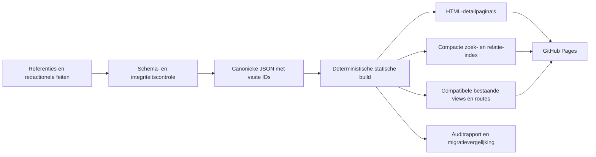

# The Kingverse 1.6 — architectuur en The Connected Kingverse

Status: gecontroleerd ontwerp, nog niet geïmplementeerd. Peildatum: 25 oktober 2026. Onderzochte applicatiebasis: commit `ca5f336f72ad6c41a28e30d3ac79a4667b5c9032` (1.5.1). Deze opdracht wijzigt uitsluitend dit document en `ROADMAP.md`; de applicatie blijft versie 1.5.1.

## 1. Besluiten

Behoud GitHub Pages, HTML, CSS en JavaScript. Normaliseer de redactionele brondata in gewone JSON-bestanden, valideer die tijdens de build en genereer daaruit compacte zoekgegevens, statische detailpagina’s en compatibele bestaande catalogusweergaven. Introduceer geen framework, database, graphserver, accountdienst of runtime-API voor de basisencyclopedie. Het netwerk van relaties is een geïndexeerde verzameling getypeerde verbindingen; een interactieve grafiek is een latere weergave daarvan.

Engels blijft de eerste ontwikkeltaal en de standaard voor nieuwe bezoekers. Behoud Nederlandse titels, edities, opgeslagen taalvoorkeur en bestaande fallbackregels. Verdere Nederlandse uitwerking en nieuwe beeldresearch blijven uitgesteld. Het ontwerp ondersteunt die gegevens wel.

StephenKing.com is de primaire bibliografische standaard. **IMDb** is de gekozen aanvullende bron voor screen-omschrijvingen en gebruikersscores. Op expliciete verduidelijking van de gebruiker wordt geen OMDb-integratie ontworpen. Productie-, distributeurs- en streamingbronnen blijven leidend voor credits en actuele adaptatiestatus.

De eerste implementatie wordt een schema- en migratieproef met The Talisman. Deze ontwerpcommit bouwt die proef nog niet.

## 2. Analyse van de huidige applicatie

### 2.1 Wat na 1.4 is verbeterd

| Basis | Aantoonbare verandering |
| --- | --- |
| `5e202ea` / 1.4 | HTML, presentatie, runtime en catalogus gesplitst; taalgebonden covers en remake-specifieke posters toegevoegd. |
| `cc4979d` / 1.5 | Officiële inventarisatie, werk-/editie-identiteiten, bundelrelaties, auteursrollen, samenwerkingenfilter, bronrapporten, Engelse standaard, hash-navigatie en Sources & Method-pagina. |
| `ca5f336` / 1.5.1 | Vier aanvullende screen-records per veld gecontroleerd; IMDb-verwijzingen, korte beschrijvingen, drie opgeslagen scores en één expliciet onbevestigde score. |

De huidige scheiding is bruikbaar: `index.html` en `about.html` vormen de pagina’s, `styles.css` de presentatie, `app.js` de runtime, `catalog.js` en `media.js` de gegenereerde data. `scripts/build_catalog.py` en `scripts/report_quality.py` maken die bestanden uit referentiesnapshots en redactionele correcties. De ongewijzigde 1.4-import en toenmalige weergavedata blijven apart bewaard. Normaal bezoek vereist geen build of installatie; redactionele wijzigingen hebben wel een offline generatieproces.

### 2.2 Omvang en betrouwbaarheid

Volgens de gecontroleerde lokale bestanden `data/quality-summary.json` en `data/audit.json`:

| Groep | Huidige omvang | Betekenis en beperking |
| --- | ---: | --- |
| Bibliotheek | 86 | Romans, bundels, novellen en enkele andere samenwerkingsprojecten; geen 86 unieke romans. |
| Verhalenweergave | 173 | Unieke verhaal-/bundelbijdragen, inclusief enkele gedichten, essay- en scenariobijdragen. |
| `works` | 256 | Gedeelde literaire identiteiten, inclusief 15 met `kind: collection`; bibliotheek/verhalen zijn deels overlappende weergaven. |
| `editions` | 154 | Editievoorbeelden, grotendeels ontstaan uit beeldkandidaten; niet alle historische uitgaven. |
| Adaptaties | 96 | 90 primaire bronentiteiten plus zes aanvullingen; geen uitputtende inventaris van korte films, afleveringen en franchise-uitbreidingen. |
| Tower-connecties | 17 | Toelichting, bron en zekerheidsniveau; concepten/personages/plaatsen zijn nog tekstlabels. |
| Samenwerkingen | 13 | Alle 11 regels van de officiële samenwerkingsindex vergeleken, plus aanvullingen; niet elk project is gezamenlijk geschreven fictie. |

De inventarisatiescope is volledig op aanwezigheid vergeleken, maar 85 bibliotheekrecords, 173 verhaalrecords en 92 adaptatierecords hebben minstens één open auditveld. Bij 29 adaptaties staat de bronrelatie nog open, ook wanneer een kandidaat-werkkoppeling al bestaat. Een resolvabele link bewijst dus geen geverifieerde adaptatierelatie. Eerste-publicatiegeschiedenis is vrijwel overal nog een afzonderlijke onderzoekstaak. Brooks is slechts via uitgevers-/bibliotheekmetadata geraadpleegd. Die grenzen uit `DATA-QUALITY.md` blijven leidend.

Er zijn 61 NL- en 86 EN-boek/bundelcovers en 82 posters geregistreerd. 145 bijdragen gebruiken terecht een bundelcover. Deze aantallen zijn geen doel voor nieuwe beeldresearch in deze fase.

### 2.3 Architectuurproblemen, op prioriteit

1. **De weergavedata is nog het feitelijke domeinmodel.** `books`, `stories` en `films` bevatten herhaalde titels, namen en metadata. Het compacte `works`-overzicht wordt daaruit achteraf afgeleid en bezit niet alle feiten. Nieuwe relaties moeten rechtstreeks naar canonieke entiteiten kunnen wijzen.
2. **Identiteiten worden opnieuw berekend uit veranderlijke waarden.** Werk-IDs volgen titel-slugs, film-IDs titel/jaar, editie-IDs ISBN of een hash met bron-URL. Correcties kunnen IDs en deeplinks veranderen. Bewaar bestaande IDs en leg nieuwe IDs éénmaal vast in een register.
3. **Relaties verwijzen deels naar een weergave of titel.** `collectionIds` verwijzen naar `books:*`; `sourceWorks` naar boek-/verhaalweergaven. Bundelrelaties en sommige bronkoppelingen worden via genormaliseerde titels teruggevonden. Dat schaalt slecht bij gelijknamige verhalen, bundels en remakes.
4. **Edities zijn te sterk aan afbeeldingen gekoppeld.** Een werk zonder coverkandidaat kan onvoldoende editiegegevens hebben. Een afbeelding op een werkpagina met onbekend ISBN wordt als editievoorbeeld bewaard, maar identificeert niet vanzelf de eerste druk. ISBN, editie en beeldgoedkeuring moeten afzonderlijk te controleren zijn.
5. **Bronadministratie is versnipperd.** `Bron`, `sources`, `audit.fields`, lokale snapshots en aparte overrides gebruiken verschillende structuren. Eén `checked`-datum maakt niet ieder veld actueel. Auditstatus, interpretatiezekerheid, toegang en datumsemantiek moeten los van elkaar worden opgeslagen.
6. **Mensen en fictieve entiteiten ontbreken als eigen gegevens.** Auteursrollen bestaan, maar dezelfde namen worden herhaald. Cast is vaak een tekstregel met acteur en personage samen. Personages, verschijningsvormen, locaties en cosmologische interpretaties zijn nog geen navigeerbare identiteiten.
7. **Runtime combineert meerdere verantwoordelijkheden.** `app.js` bevat zoeken, taal, routing, filtering, mediaselectie, HTML-opbouw en modalbeheer. De bestaande 26 Node-tests gebruiken een DOM-stub; ze vervangen geen echte browser-, toegankelijkheids- of performancetest.
8. **Alle catalogusdata wordt direct geladen.** Ongecomprimeerd zijn `catalog.js` 809.575 bytes en `media.js` 320.517 bytes: samen circa 1,13 MB. Auditdetails en dubbele feiten reizen mee naar iedere bezoeker. Zoeknormalisatie en `.find()`-relaties worden tijdens renderen herhaald. Meet werkelijke overdracht en verwerking voordat verdere optimalisatie nodig wordt verklaard.
9. **Persoonlijke gegevens hebben nog geen eigen grens.** Legacyvelden zoals `Status: Gelezen` staan in catalogusrecords. Dit is geen veilige basis om alle bezoekers een persoonlijke leesstatus toe te kennen. Bewaar herkomst tijdens migratie, maar scheid toekomstige persoonlijke lijsten van publieke bibliografische feiten.

Zoeken ondersteunt nu live invoer, knop en Enter via één actie, exacte titels, andere-taaltitels, auteurs en gekoppelde bundels. Filters werken per type/bundel en op samenwerkingen; sortering op jaar/titel. Vier hash-routes en details bewaren zoek/filter/sorteerstatus en ondersteunen terug/vooruit. EN/NL-tekst zit deels in runtimevertalingen en deels in records. Personagezoekwerk, samengestelde relatie-/bronfilters, spoilerbescherming en persoonlijke lijsten ontbreken. Deze bestaande functies zijn migratiecontracten.

### 2.4 IMDb: huidige werkelijkheid en gewenste grens

Een repositorybrede inspectie vindt geen OMDb-client, OMDb-key of OMDb-fetch. De vier `imdb`-objecten komen uit `data/reference/screen-1.5.1.json`. Carrie (2013), The Dead Zone (2002) en Haven hebben een score; Carrie (2002) heeft `null`. Het zijn waarnemingen uit geïndexeerde IMDb-resultaten, geen live API-resultaten. De Carrie-beschrijvingen gebruiken andere expliciet genoemde bronnen wegens ontoegankelijke IMDb-hoofdpagina’s.

Aanbevolen na de aanvullende API-vraag: gebruik de officiële IMDb-API als voorkeursadapter voor een redactionele import buiten de bezoeker-runtime, zodra passende toegang en publicatierechten geregeld zijn. Zoek steeds de exacte IMDb-ID voor titel, jaar en formaat; geen koppeling op titel alleen. Bewaar score, schaal, eventueel bevestigd stemaantal, bron, `observedAt`, `sourceUpdatedAt` indien bekend, `accessMethod` en toegangsstatus. Onbekende bronupdatedatum blijft `null`; een raadpleegdatum bewijst geen versheid van een zoekindex. Vermeld zichtbaar “IMDb user rating — cached observation”, datum en link. Een score is geen leeftijdsclassificatie. Verzin ontbrekende scores/stemaantallen niet.

Schrijf korte beschrijvingen zelf op basis van toegankelijke feiten en vermeld de werkelijke beschrijvingsbron; een fallback wordt niet ten onrechte IMDb genoemd. Bewaar geen volledige IMDb-synopsis of reviews. Geen automatische scraping, toegangsbeperking-omzeiling of veronderstelde licentie. De [officiële IMDb API](https://data.imdb.com/documentation) is een GraphQL-dienst via AWS Data Exchange; [IMDb beschrijft toegang en abonnement](https://help.imdb.com/article/contribution/new-features-updates/introducing-the-imdb-api/G49M5Y59L5N4WABM). Beschikbare velden en rechten voor publieke weergave, caching, afgeleide omschrijvingen, attributie en bewaartermijnen hangen af van het gekozen pakket en contract. Leg die voorwaarden vóór import vast als importconfiguratie. Beschouw de gratis niet-commerciële datasets niet als automatische toestemming voor deze publieke encyclopedie: [IMDb beperkt herpublicatie en website-extractie](https://help.imdb.com/article/imdb/general-information/can-i-use-imdb-data-in-my-software/G5JTRESSHJBBHTGX). De huidige opgeslagen waarnemingen worden door dit ontwerp niet automatisch gelicentieerd; neem hun hergebruik mee als open releasecontrole vóór uitbreiding. Er wordt hier geen abonnement afgesloten en geen huidige data gewijzigd.

Voorgestelde stroom: exacte IMDb-ID’s → geautoriseerde importtaak met afgeschermde AWS-credentials → validatie en redactionele review → alleen toegestane rating-/beschrijvingsvelden en provenance → statische JSON. Bewaar geen volledige API-respons in een publieke snapshot. Gebruik een handmatig gestarte import met caching, beperkte batches, foutafhandeling en controle op quota/kosten; geen live API-call per bezoeker. Configureer toekomstige credentials als CI-secrets of lokale afgeschermde credentials, nooit in repository, frontend, logs of previewbestanden. Een toekomstige Actions-import gebruikt minimale rechten en draait niet op onbeoordeelde forkcode. Houd import los van de normale offline build en laat fouten de laatst geldige toegestane dataset intact. Indien een bewaartermijn verloopt, sluit de build verlopen velden uit; toon “Rating unavailable” en een IMDb-link in plaats van stilzwijgend oneindig cachen. Geen key of toegang betekent een werkende encyclopedie zonder onbevestigde nieuwe scores. Korte omschrijvingen krijgen steeds de werkelijk gebruikte bron en worden alleen binnen de overeengekomen hergebruikmogelijkheden geschreven.

### 2.5 GitHub Pages

[GitHub Pages](https://docs.github.com/en/pages/getting-started-with-github-pages/what-is-github-pages) publiceert statische bestanden. Er is geen eigen serverproces voor geheime credentials, API-proxy, databasewrites of gebruikerssessies. Alle gepubliceerde JSON en JavaScript is openbaar. Een API-key in frontendcode is dus ongeschikt. Ook bestanden met referenties kunnen publiek worden als ze in het publicatieartefact staan; neem alleen bewust publieke feiten en noodzakelijke provenance op.

Gebruik echte gegenereerde detailpaden zoals `works/the-talisman/index.html`, met relatieve of configureerbare `/the-kingverse/`-basispaden. Die laden rechtstreeks zonder SPA-rewrite of misbruik van een 404-pagina. Behoud bestaande hash-links via een compatibiliteitsrouter. Een gewijzigde vriendelijke slug krijgt een gegenereerde verwijspagina; het entity-ID verandert niet. Server-side 301-regels zijn geen uitgangspunt.

De [gedocumenteerde limieten](https://docs.github.com/en/pages/getting-started-with-github-pages/github-pages-limits) zijn onder meer 1 GB gepubliceerde site, 10 minuten deploymenttimeout en een zachte 100 GB maandbandbreedte. De zachte limiet van 10 builds per uur geldt niet op dezelfde manier voor een eigen Actions-publicatieworkflow. Dit zijn randvoorwaarden, geen belofte van capaciteit. De huidige repository heeft geen eigen `.github`-workflow; Pages bouwt nu via de geconfigureerde Pages-deployment. Een toekomstige gecontroleerde build moet expliciet worden ingericht, niet als al bestaande infrastructuur worden beschreven.

Genereer bij een latere migratie een geselecteerd publicatieartefact. CI kan offline bouwen uit gecommitteerde feiten; een eventuele geautoriseerde externe import blijft een aparte handmatige/redactionele stap. Geen geplande scraping nodig. Persoonlijke lijsten blijven eerst op het apparaat met export/import; synchronisatie zou een afzonderlijke architectuurbeslissing vergen.

## 3. Aanbevolen datamodel

### 3.1 Regels voor identiteit en data-eigenaarschap

Gebruik UTF-8 JSON, `schemaVersion: 2`, gecontroleerde enumeraties en JSON Schema (draft 2020-12). Een kleine offline validator controleert daarnaast referentiële integriteit en inhoudelijke regels die JSON Schema niet kan bewijzen. Data hoort in `data/v2/`; dit is een voorgestelde locatie, geen in deze opdracht aangemaakte map.

Ieder record heeft `id`, `entityType`, `slug`, `aliases`, `verification` en waar nodig gelokaliseerde tekst. IDs worden eenmalig redactioneel toegekend, nooit herberekend na een titel-, jaar-, bron- of ISBN-correctie. Nieuwe IDs gebruiken een leesbare typeprefix en een handmatig toegewezen onderscheidend suffix bij botsingen. Bestaande IDs blijven bevroren: bijvoorbeeld `work:the-talisman` en `edition:9789021037400`. Ook bestaande collectie-identiteiten zoals `work:collection:night-shift` mogen als ID in de nieuwe `collections` blijven bestaan; `entityType` bepaalt het type. Nieuwe collecties krijgen `collection:*`. Prefixverschil is minder kostbaar dan kapotte verwijzingen.

Een centraal ID-/aliasregister voorkomt botsingen en bewaart oude `books:*`, `stories:*`, `films:*` en eerdere routes. Een naamsalias is geen bewijs dat twee entiteiten identiek zijn. ISBN, IMDb-ID en bron-URL zijn externe identifiers met hun eigen verificatie; geen primaire sleutel. Een taalvertaling of nieuwe editie maakt geen nieuw literair werk. Een substantieel herziene tekst wordt eerst als versie binnen hetzelfde werk vastgelegd; opsplitsen vraagt een onderbouwde redactionele beslissing en migratiemapping.

### 3.2 Entiteiten en ondersteunende relaties

| Entiteit / bestand | Kernvelden | Eigen verantwoordelijkheid |
| --- | --- | --- |
| `works` | `id`, `kind`, `originalTitle`, `originalLanguage`, `aliases`, `summary`, `versionNotes` | Unieke roman, novelle, kort verhaal, maar ook de behouden soorten essay, gedicht, scenario, comic en non-fictie. Geen verlies van bestaande bijdragen door een te nauwe typekeuze. |
| `collections` | `id`, `originalTitle`, `collectionKind`, `summary` | Zelfstandig bundelconcept; niet opnieuw opgenomen als roman in `works`. |
| `collectionMemberships` | `id`, `collectionId`, `workId`, `order`, `editionIds`, `verification` | Veel-op-veelopname; onbekende volgorde blijft `null`. Een editiespecifieke inhoud kan verschillen van de bundel als concept. |
| `editions` | `id`, `publicationOf: {type,id}`, `language`, `title`, `isbn13`, `publisher`, `publicationDate`, `format`, `translationCredits`, `identityStatus` | Concrete taal-/uitgavegegevens bij één werk of bundel. Ontbrekende druk/ISBN maakt het record een expliciet onvolledig editievoorbeeld, geen bewezen eerste druk. |
| `adaptations` | `id`, `title`, `format`, `externalIds`, `releaseEvents`, `statusHistory`, `summary`, `ratingObservations` | Afzonderlijke film, serie, miniserie, TV-film of behouden overige screen-vorm; onderscheiden productie-incarnaties en remakes. |
| `people` | `id`, `name`, `aliases`, `pseudonyms`, `externalIds` | Echte mensen: auteurs, vertalers, acteurs, regisseurs en andere makers. Bachman is een schrijfnaam van dezelfde persoon. |
| `credits` | `id`, `personId`, `subject: {type,id}`, `role`, `creditedAs`, `scope`, `characterId`, `verification` | Een maker kan meerdere rollen hebben. Acteur/personagekoppeling is adaptatiespecifiek. Fotograaf, voorwoordschrijver en vertaler zijn geen automatische co-auteurs. |
| `characters` | `id`, `name`, `aliases`, `continuity`, `summary` | Fictieve identiteit; gelijknamige of parallelle versies niet automatisch samenvoegen. Spoilergevoelige aliassen krijgen een zichtbaarheidsscope. |
| `locations` | `id`, `name`, `locationKind`, `continuity`, `summary` | Fictieve plaats, regio of wereld. Geen verplichte geografische coördinaten voor verzonnen werelden. |
| `connections` | `id`, `from`, `predicate`, `to`, `certainty`, `explanation`, `spoiler`, `verification` | Onderbouwde verbinding tussen getypeerde entiteiten; geen los tekstlabel dat een verifieerbare relatie vervangt. |
| `sources` | `id`, `url`, `publisher`, `sourceType`, `publishedAt`, `observedAt`, `access`, `snapshotRef` | Bronidentiteit en toegang. Een bron is geen blanket-keurmerk voor het hele record. |
| `claims` | `id`, `subject`, `fieldPath`, `value`, `sourceIds`, `locator`, `status`, `observedAt`, `decisionNote` | Herleidbare veldbewering; meerdere conflicterende waarden mogen blijven bestaan. Geselecteerde waarden verwijzen naar hun claim-ID. |
| `publicationEvents` | `id`, `subject`, `eventType`, `date`, `territory`, `editionId`, `part`, `claimIds` | Eerste publicatie, tijdschriftpublicatie, seriële aflevering, herziening en herdruk gescheiden van de werkidentiteit. |
| `artworks` | `id`, `editionId` of `adaptationId`, `kind`, `url`, `language`, `review`, `sourceId`, `rightsNote` | Cover bij een editie; poster bij de juiste adaptatie. Beeldstatus staat los van bibliografische verificatie. |

`from`, `to`, `subject` en `publicationOf` zijn altijd getypeerde referenties `{ "type": "work", "id": "work:the-talisman" }`; geldige typen zijn centraal vastgesteld. Collections, people en characters worden niet als werken vermomd om een generieke grafiek mogelijk te maken. Credits en bundellidmaatschappen blijven eigen relaties omdat ze extra domeinvelden hebben. Reverse-lijsten worden gegenereerd, niet dubbel geredigeerd.

Publicatie-events maken The Green Mile tot één roman met zes seriële gebeurtenissen. Een verhaal in drie bundels blijft één werk met drie memberships. Een editie is geen cover en een cover bewijst geen ISBN. Behoud bestaande goedgekeurde beelden zonder nieuw onderzoek; individuele verhalen gebruiken standaard de eerste/relevantste geregistreerde bundeluitgave in de actieve taal. Alleen bewijs van een zelfstandige editie rechtvaardigt een eigen cover. De kwaliteitsrapportage telt geen ontbrekende eigen cover voor een uitsluitend gebundeld verhaal.

### 3.3 Verificatie, datums en status

Een datum is `{ "value": "1984-11", "precision": "month", "meaning": "source-reported-release", "territory": null }`. Toegestane precisies zijn `year`, `month`, `day`; ontbrekend is `null`. `1984-11-01` is geen vervanging voor een onbekende dag. `first-publication`, `US-series-premiere`, `festival-premiere`, `theatrical-release` en `edition-publication` zijn verschillende betekenissen. “Eerste” vereist een eigen onderbouwde claim.

Claimstatus: `verified` (bewijs ondersteunt precies dit veld), `provisional` (overgenomen/nog beperkt gecontroleerd), `disputed` (conflict), `unknown` (geen bruikbaar bewijs). Brontoegang heeft apart `available`, `indexed-only`, `blocked`, `unavailable`. Leg ook vast of onafhankelijk is bevestigd; één officiële bron is niet automatisch onafhankelijke verificatie. `verification` op een entiteit verwijst naar claim-IDs en open onderzoekspunten; een algemeen groen “alles geverifieerd” is niet toegestaan.

Connection-zekerheid blijft afzonderlijk: `explicit`, `strongly-implied`, `interpretive`. Een goed onderbouwde interpretatie blijft interpretatief. De bron moet de concrete formulering ondersteunen. `same_as` en identiteit van parallelle personages vergen expliciet bewijs; gedeelde thema’s zijn daarvoor onvoldoende. Cosmologische termen zoals “The White” blijven in deze eerste fase getypeerde onderwerpstags binnen een toelichting; maak ze niet ten onrechte tot een persoon of locatie. Een afzonderlijke `concepts`-entiteit wordt pas toegevoegd als concrete navigatie dat nodig maakt.

Een adaptatie heeft bronwerkrelaties met predicates `adaptation_of`, `inspired_by`, `prequel_to` of `sequel_to`, met eigen evidence. `statusHistory` registreert bijvoorbeeld `announced`, `development`, `production`, `released`, `cancelled` of `unknown`, plus projectscope, peildatum en claims. Een oud projectbericht bewijst geen huidige productie. Stopzetting van één Netflix-project bewijst geen eeuwigdurende afwezigheid van iedere mogelijke verfilming. Ook originele scenario’s zonder afzonderlijk bronboek blijven geldige records.

### 3.4 Voorbeeldcontract: The Talisman

Onderstaand geldig JSON is een ontwerpvoorbeeld, geen nieuw catalogusrecord. Claims zijn hieronder schematisch aangeduid; de concrete bronbetekenissen staan in §5. Alleen bestaande werk-/editie-IDs worden hergebruikt; voorgestelde credit-, personage- en relatie-IDs moeten in de proef aan het register worden toegevoegd.

```json
{
  "schemaVersion": 2,
  "work": {
    "id": "work:the-talisman",
    "entityType": "work",
    "slug": "the-talisman",
    "kind": "novel",
    "originalTitle": "The Talisman",
    "originalLanguage": "en",
    "aliases": [{"language": "nl", "value": "De talisman"}],
    "verification": {"claimIds": ["claim:talisman-title", "claim:talisman-authors"], "open": ["firstPublicationHistory"]}
  },
  "credits": [
    {"id": "credit:talisman-king", "personId": "person:stephen-king", "subject": {"type": "work", "id": "work:the-talisman"}, "role": "coauthor", "scope": "whole-text"},
    {"id": "credit:talisman-straub", "personId": "person:peter-straub", "subject": {"type": "work", "id": "work:the-talisman"}, "role": "coauthor", "scope": "whole-text"}
  ],
  "publicationEvent": {
    "id": "publication:talisman-source-release",
    "subject": {"type": "work", "id": "work:the-talisman"},
    "eventType": "source-reported-release",
    "date": {"value": "1984-11", "precision": "month", "meaning": "source-reported-release", "territory": null},
    "claimIds": ["claim:talisman-release"]
  },
  "editionIds": ["edition:9789021037400", "edition:1de916e95d67fdd3"],
  "connection": {
    "id": "connection:black-house-sequel-talisman",
    "from": {"type": "work", "id": "work:black-house"},
    "predicate": "sequel_to",
    "to": {"type": "work", "id": "work:the-talisman"},
    "certainty": "explicit",
    "spoiler": {"level": "none", "workIds": []},
    "verification": {"claimIds": ["claim:black-house-sequel"], "open": []}
  }
}
```

Het voorbeeld is bewust geen volledige fixture: bij implementatie leveren aparte `people`, `sources` en `claims`-records de genoemde referenties. Beide schrijvers krijgen gelijkwaardige tekstcredits; de oorspronkelijke rolwaarden uit 1.5 blijven traceerbaar in de migratiemapping.

## 4. Runtime en publicatiearchitectuur



Voorgestelde toekomstige modules: `data-access` (manifest/index/ID-resolutie), `search`, `routing`, `i18n`, `render`, `media`, `preferences`. Gebruik gewone ES-modules en pure domeinfuncties. Migreer geleidelijk achter bestaande UI-contracten; geen gelijktijdige visuele herbouw.

De build levert een manifest met schema-/datasetversie en inhoudshashes, een compacte zoekindex, relationele adjacency-indexen en detailbestanden per entiteit. De eerste pagina toont bruikbare HTML zonder JavaScript; JS voegt filters, “Explore connections” en opgeslagen voorkeuren toe. Onnodige audit-snapshots worden niet in de initiële payload opgenomen. Statische pagina’s tonen wel kernbronnen en onzekerheden. Voor identiteit en rendering geldt één canonieke bron; zoekdocumenten en omgekeerde relaties zijn afgeleide caches.

Meet als eerste budget: maximaal 300 kB ongecomprimeerde initiële zoekindex inclusief benodigde samenvattingen, maximaal 100 kB detail-JSON per gewone werkpagina en geen volledige referentiesnapshot op de kritieke laadroute. Dit zijn toekomstige acceptatiebudgetten, geen huidige metingen. Meet ook echte netwerkoverdracht, parseertijd, interactie en DOM-grootte op mobiel; kies pas daarna een worker of verdere splitsing. De catalogusomvang rechtvaardigt nu geen externe zoekdienst.

## 5. The Kingverse Explorer — volledig uitgewerkt ontwerpvoorbeeld

### 5.1 Pagina en interactie

Voorgestelde route: `works/the-talisman/`, documenttaal eerst Engels. De bestaande `#books?item=books%3Athe-talisman` blijft werken. Een gewone detailpagina vervangt voor dit voorbeeld de modal als primaire deelbare leeservaring; de huidige modal blijft tijdens migratie bestaan.

```text
The Talisman                         [EN / NL] [Spoilers: Off]
Novel · Stephen King & Peter Straub · 1984
[Overview] [Publication history] [Editions] [Connections]
[Characters & places] [Adaptations] [Sources]

Short introduction                   Read next: Black House →
Publication timeline                 EN edition | NL edition
Explore connections                  [List] [Map — later]
Characters / locations               Source & verification per claim
Adaptation project history           Open research questions
```

Op mobiel staan secties onder elkaar, met een korte inhoudsopgave en ankerlinks. Alle essentiële acties zijn gewone links/knoppen, toetsenbordbedienbaar, met zichtbare focus. Gebruik de bestaande donkere identiteit, goudaccenten en typografie. Geen cover is nodig om de pagina te begrijpen; gebruik bestaand goedgekeurd beeld of een placeholder.

### 5.2 Concrete inhoud, bewijs en publicatiegrenzen

| Blok | Voorstel voor inhoud | Bron en verificatiegrens |
| --- | --- | --- |
| Introductie | Eigen korte Engelse tekst: “Jack Sawyer crosses between America and the Territories on a dangerous journey to help his mother.” | Afgeleid uit de officiële King-werkpagina; geen overgenomen synopsis. Spoilerniveau `premise`. |
| Auteurs | Stephen King en Peter Straub, beiden co-author; klik opent eigen people-pagina. | Officiële Talisman-pagina bevestigt Peter Straub als medeschrijver; bestaande audit bewaart dit al. |
| Publicatie | “Source-reported release: November 1984”; historische uitgever G.P. Putnam's & Sons volgens bron. | Maandprecisie behouden. Eerste druk, exacte dag, oorspronkelijke ISBN en verdere drukgeschiedenis blijven open totdat uitgevers-/bibliotheekbewijs is geraadpleegd. |
| Leesvolgorde | Black House (2001), expliciet vervolg; knop opent het werk. | Officiële Black House-pagina noemt het vervolg. Alleen de sequel-relatie is spoilervrij; plotinformatie van het vervolg wordt apart afgeschermd. |
| Overige geregistreerde reeksinformatie | Het bestaande record Other Worlds Than These blijft in de migratie behouden en kan later bij de reeks getoond worden. | De huidige dataset bevat dit record; de titel-, datum- en auteursclaims ervan zijn in deze beperkte ontwerpcontrole niet opnieuw onafhankelijk onderzocht. Geen automatische nieuwe reeksclaim op de voorbeeldpagina. |
| NL-editie | De talisman (POD), ISBN 9789021037400; bestaande `edition:9789021037400`. | Reeds vastgelegde Luitingh-Sijthoff-bron. Geen bewering dat dit de eerste Nederlandse editie is. Uitgeverpagina was tijdens deze ontwerpronde niet toegankelijk via de webtool; oude evidence niet als nieuw gecontroleerd presenteren. |
| EN-editie | Bestaand `edition:1de916e95d67fdd3`, Engelse werkpagina-afbeelding. | ISBN/druk niet bevestigd; toon “Edition details incomplete”. Gebruik dit beeld niet als bewezen cover van de eerste druk. |
| Personages | Jack Sawyer; Lily Cavanaugh Sawyer. Mogelijke uitbreiding: Wolf en Speedy Parker pas na controle van naam/identiteit en spoilerlabels. | Officiële Characters-sectie bevat Jack en Lily. Voor het prototype volstaan de twee gecontroleerde identiteiten; relaties worden afzonderlijk onderbouwd. Geen hele personagelijst automatisch importeren, want die bevat spoilers en vermeldingen van echte personen. |
| Locaties | The Territories als fictieve wereld; relatie `set_in` naar The Talisman. | Officiële werkpagina en officiële Tower Connections. Andere locaties blijven onderzoekskandidaten; geen verzonnen coördinaten. |
| Tower-verwijzing | “The Territories are named in The Waste Lands.” Een afzonderlijk blok licht de vermelding van The White toe. | Officiële Connections-pagina noemt deze concrete verwijzingen. Dit ondersteunt expliciete tekstverwijzingen, niet automatisch gelijkheid van alle werelden of een causale kosmologie. |
| Interpretatie | “These references suggest a wider shared cosmology.” | Redactionele gevolgtrekking, zichtbaar `strongly-implied` of `interpretive` volgens precieze claim; nooit omgezet in canon omdat de bron officieel is. Bestaande brede Talisman-connectie blijft behouden tot redactionele opsplitsing. |
| Adaptaties | Projectgeschiedenis met laatste bronstatus, zonder releasebelofte. | In de huidige 96 screen-records bestaat geen Talisman-adaptatierecord. Dat betekent geen bewezen afwezigheid van alle adaptaties of projecten. Zie §5.3. |
| Betrouwbaarheid | Per feit bronlink, bronsoort, raadpleegdatum, precieze claim en open punten; bronconflicten uitklapbaar. | Geen algemeen “verified book”-label. Geen percentage zonder gedefinieerde veldscope. |

Belangrijke bronnen voor het voorbeeld, geraadpleegd op 25 oktober 2026:

- [StephenKing.com — The Talisman](https://stephenking.com/works/novel/talisman.html): titel, medeauteur, maand, uitgeversvermelding, premise en personages. Geen onafhankelijke drukgeschiedenis.
- [StephenKing.com — Black House](https://stephenking.com/works/novel/black-house.html): expliciete sequel-relatie; de bron bevat plotspoilers.
- [Official Dark Tower Connections](https://stephenking.com/darktower/connections/): Territories-vermelding in The Waste Lands en The White. Pagina-/hoofdstuklocators uit de oorspronkelijke tekst blijven latere verdiepingscontrole.
- [Luitingh-Sijthoff — De talisman (POD)](https://www.lsuitgeverij.nl/boek/de-talisman-pod/): bestaande editie-evidence in de repository; huidige toegankelijkheidsgrens hierboven vastgelegd.

### 5.3 Adaptaties: concreet ontwerp bij onzekere actualiteit

De pagina krijgt het blok **“Adaptation projects — current release unconfirmed”**, met een apart item voor het historische Netflix/Duffer-project. Een [rechtstreeks interview met de Duffers uit 2022](https://www.vanityfair.com/hollywood/2022/05/stranger-things-explained-duffer-brothers) beschrijft de toenmalige ontwikkeling. [Berichtgeving uit december 2025](https://www.whats-on-netflix.com/news/the-duffer-brothers-adaptation-of-stephen-kings-the-talisman-scrapped-at-netflix/) meldt hun vertrek en het stoppen bij Netflix op basis van een CBR-interview. Het oorspronkelijke CBR-interview en een actuele productiebevestiging zijn in deze ontwerpronde niet rechtstreeks geraadpleegd.

Daarom krijgt het ontwerp twee onderscheiden bronbeweringen: historische ontwikkeling bevestigd door het toenmalige makersinterview; einde van de Netflix-incarnatie voorlopig op aanvullende berichtgeving, met herverificatie als open taak. Geen huidige release, cast, score of productiedatum invullen. Een later elders herstart project krijgt een afzonderlijke projectidentiteit of expliciet onderbouwde continuïteit. IMDb wordt pas gekoppeld als een exacte titel-ID deze productie-incarnatie aantoonbaar identificeert. Geen IMDb-score van een gelijknamige film overnemen.

Dit document corrigeert geen catalogusdata. De implementatie moet de projectstatus eerst opnieuw bij makers/studio/distributeur controleren en bronclaims vastleggen. “Geen release bevestigd in onze bronnen” is een correcte lege toestand; “er bestaat geen verfilming” gaat verder dan het bewijs.

### 5.4 Spoilers en verbonden navigatie

Start met `off`: alleen neutrale metadata en premise zichtbaar. Relatie- en personageblokken hebben `spoiler.level: none | premise | plot | ending` en betrokken `workIds`. Bij ontbrekend label is plotinhoud standaard verborgen. “Show spoilers for this work” onthult geen spoilers van Black House of The Dark Tower. Leesstatus geeft nooit automatisch spoilerconsent.

Verberg ook gevoelige aliassen, zoekfragmenten, relatielabels, grafieknamen en toegankelijke teksten; alleen tekst vervagen met CSS is onvoldoende. De standaardpagina levert geen verborgen spoilerparagrafen mee in initiële HTML, metadata of JSON-LD. Afzonderlijke spoilerfragmenten mogen na expliciete keuze geladen worden. Dit is inhoudsbescherming voor normaal gebruik, geen toegangscontrole: gepubliceerde statische data blijft vindbaar voor wie direct bestanden opvraagt.

Verbindingslijst is de standaard. Een latere kaart toont aanvankelijk één stap rond The Talisman, filters op entiteittype en zekerheid, en maximaal 30 zichtbare knopen. “Show more” breidt expliciet uit. De lijst biedt dezelfde informatie en bediening; canvas of force-layout mag geen voorwaarde zijn. Ieder verband opent uitleg plus bron, niet alleen een lijn. Zoek naar Jack of de Territories werkt via dezelfde IDs als de werkdetailpagina.

## 6. Migratieaanpak en permanente afspraken

Migreer eerst in de schaduw: oude data en UI blijven leidend tot equivalentie is bewezen. Maak een expliciete mapping van elke legacy-entiteit, ieder veld, iedere route en iedere mediakoppeling naar de nieuwe representatie. Behoud oorspronkelijke import, snapshots, afgewezen beeldkandidaten en conflictsituaties. Onbekende velden krijgen een gedocumenteerde bewaarplaats met oorspronkelijke JSON-pointer; ze verdwijnen niet stilzwijgend.

Verplaats de 15 bestaande collectie-identiteiten uit de `works`-weergave naar `collections` zonder de IDs te veranderen. Een totaal van 256 wordt daardoor niet plots 241 “verdwenen werken”: de controle vergelijkt de unie van werken en collecties. De huidige drie novella-overlappingen blijven één werk per identiteit met meerdere views. Mappingtests bewijzen de Green Mile-consolidatie, Bachman-romans, N/N.-aliassen, gelijknamige Hearts in Atlantis-entiteiten en remake-botsingen. Titelnormalisatie dient alleen kandidaatmatching; definitieve merges vragen vastgelegde evidence en beslissing.

Persoonlijke legacy-status blijft bewaard in het expliciete legacy-archief/migratierapport, wordt geen publieke canonieke werkclaim en wordt niet voor nieuwe bezoekers geïmporteerd als hun leesstatus. Geen nieuwe gebruikersgegevens uploaden. Verwijderen of privatiseren van bestaande archiefvelden zou een afzonderlijke redactionele beslissing zijn; deze opdracht doet dat niet.

Een compatibiliteitsadapter genereert tijdens de overgang de bestaande `DB`/`MEDIA`-vorm en route-aliases uit het nieuwe model. Voorkom twee handmatig bewerkbare waarheden: na gecontroleerde omschakeling wordt uitsluitend canonieke JSON geredigeerd. Bouw en vergelijking moeten deterministisch zijn; geen externe netwerkverzoeken tijdens normale builds. Rollback is de vorige gevalideerde publicatiecommit en bijbehorend manifest, met behoud van aliasregister en exportformaten.

Dit ontwerp volgt `AGENTS.md` en de grenzen van `DATA-QUALITY.md`: EN eerst; primaire officiële inventarisatie; controle per veld; open onafhankelijke verificatie; bijdragenrollen; cover/edition-scheiding; geen eigen verhaalcover zonder zelfstandige uitgave; geen nieuwe afbeeldingen; geen globale volledigheidsclaim. De verdere fasen en hun releasecriteria staan in [ROADMAP.md](ROADMAP.md).
