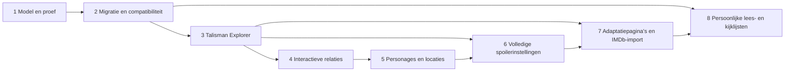

# The Kingverse 1.6 — uitvoerbare ontwikkelroadmap

Status: ontwerp, geen implementatieautorisatie binnen deze documentatieopdracht. Peildatum: 25 oktober 2026. Basis: applicatie 1.5.1, commit `ca5f336f72ad6c41a28e30d3ac79a4667b5c9032`. Het gekozen domeinmodel, de bronhiërarchie en het concrete Talisman-voorbeeld staan in [ARCHITECTURE.md](ARCHITECTURE.md).

## Uitvoeringskeuzes en volgorde

Behoud de bestaande GitHub Pages-site, identiteit, deelbare routes, zoekknop/Enter/live zoeken, filters, taalwisseling en modalfunctionaliteit tijdens migratie. Bouw eerst Engelse informatie en navigatie. Breid Nederlandse inhoud en afbeeldingen pas uit in een later door de gebruiker gekozen traject; migreer bestaande NL- en beeldgegevens wel zonder verlies.

Werk in kleine gecontroleerde releases, met offline reproduceerbare builds, gerichte tests en vergelijking tegen de vorige dataset. Voer iedere volgende fase pas uit na de acceptatiepoort van haar afhankelijkheden. De fasen hieronder zijn concrete werkpakketten, geen reeds ingeplande taken of tijdsbeloften. Deze opdracht levert uitsluitend de twee ontwerpdocumenten op.

De volledige spoilerbediening zit in fase 6, maar het dataschema krijgt spoilerlabels al in fase 1. Fase 3–5 publiceren uitsluitend veilige inhoud en expliciet afgeschermde fragmenten. Zo ontstaat geen periode waarin eerst spoilers worden gepubliceerd en later pas verborgen.

## Fase 1 — canoniek datamodel en begrensde migratieproef

**Doel en op te leveren werk.** Voeg bij een latere implementatie JSON Schema draft 2020-12, een vast ID-/aliasregister en een offline integriteitsvalidator toe. Leg works, collections, editions, adaptations, people, characters, locations, connections en sources vast, plus claims, credits, memberships, publicationEvents en artworks. Controleer bestaande bijdragegenres naast fictie. Iedere bronclaim bewaart veldscope, toegangsstatus, datumprecisie en onafhankelijke bevestiging apart van interpretatiezekerheid.

Maak een minimale fixture voor The Talisman en Black House: twee werken, twee schrijvers, twee bestaande Talisman-editievoorbeelden, sequel-relatie, twee gecontroleerde personages, de Territories, claim-/bronrecords en de oude route-aliases. Neem geen onbevestigd ISBN of adaptatieproject op als vastgesteld feit. De voorgestelde records staan eerst in een aparte proef; de live catalogus wordt nog niet omgeschakeld.

**Afhankelijkheden.** Dit ontwerp en de huidige snapshots. Geen nieuwe hostingdienst, framework, betaald IMDb-abonnement of beeldresearch nodig.

**Risico’s en maatregelen.** Titel-slugs kunnen botsen; zet IDs eenmalig vast en toets registeruniciteit. Dezelfde titel kan een verhaal en een bundel zijn; de getypeerde identiteit bepaalt het verschil. Onvolledige edities mogen niet alsnog eerste drukken worden; bewaak `identityStatus` en claimscope. Maak geen generiek grafieksysteem dat credits en uitgaven hun specifieke betekenis ontneemt.

**Acceptatiecriteria.** De Talisman-fixture valideert volledig, alle verwijzingen bestaan en beide schrijvers hebben gelijkwaardige tekstcredits. `1984-11` behoudt maandprecisie; ISBN/druk van het EN-editievoorbeeld blijft onbekend. Bestaande IDs en routes veranderen niet. De fixture kan een expliciete sequel en een interpretatief kosmologieverband onderscheiden. De proef schrijft niet naar bestaande publieke bestanden.

**Benodigde tests.** Positieve fixture; negatieve gevallen voor dubbele IDs, verkeerd entiteittype, ontbrekende bron, losse referentie, ongeldige dagprecisie, onbekend predicate, tegenstrijdige ISBN-toewijzing en spoilergevoelige alias zonder label. Test dat één naamalias geen automatische merge veroorzaakt. De bestaande 26 tests blijven groen.

## Fase 2 — migratie zonder gegevensverlies en compatibiliteitslaag

**Doel en op te leveren werk.** Migreer de volledige huidige dataset in de schaduw naar `data/v2/`. Maak per bronbestand/JSON-pointer een mapping naar nieuw veld/ID of een expliciet bewaard legacyveld met reden. Gebruik de 1.5.1-snapshots en correcties als invoer; haal niet gelijktijdig de hele bibliografie opnieuw op. Behoud originele import, bronhashes, conflicten, onzekerheden, afgewezen beelden en statusgeschiedenis. Maak een machineleesbaar verschillenrapport en een menselijk migratieverslag.

Genereer met een adapter bestaande DB-/MEDIA-weergaven uit de nieuwe gegevens. Eerste omschakeling verandert alleen de bron van de bestaande UI-data. Oude schrijfpaden worden daarna read-only; toekomstige wijzigingen gaan naar canonieke JSON. Generatie van historische bestanden uit de ongewijzigde oorspronkelijke generator blijft mogelijk als referentie, maar wordt geen tweede redactionele waarheid.

**Afhankelijkheden.** Fase 1 geaccepteerd, fixture en ID-register vastgelegd. Een expliciet gekozen lijst van publieke buildbestanden; historische researchbestanden zijn niet automatisch runtimepayload.

**Risico’s en maatregelen.** Getallen kunnen verschuiven door normalisatie. Vergelijk identiteiten en veldwaarden, niet alleen totaaltellingen. De 256 huidige werkidentiteiten omvatten 15 collecties; verplaatsen naar een aparte tabel vermindert de dekking niet. Bewaar drie boek/verhaal-overlappingen als gedeeld werk. Persoonlijke legacy-`Status` wordt geen algemene bezoekersstatus; bewaar herkomst apart. Koppel posters aan exact remake-ID, covers aan editie-ID. Nieuwe onzekere relaties blijven onzeker.

**Acceptatiecriteria.** Alle 86 bibliotheekviews, 173 verhaalviews, 96 adaptaties, 17 Tower-verbindingen en 154 editievoorbeelden zijn traceerbaar; consolidaties hebben een verklaarde mapping. De unie van works en collections dekt de huidige 256 identiteiten. Geen stilzwijgend verwijderd veld. Alle bestaande goedgekeurde mediakoppelingen en afwijzingen blijven behouden. De primaire scopes hebben dezelfde referentiedekking; open punten verdwijnen alleen door nieuw bewijs. Bestaande hashes blijven naar dezelfde werken/remakes leiden.

**Benodigde tests.** Automatische oude/nieuwe veldvergelijking en mappingdekking, dangling references, herhaalde build met identieke hashes, oude deeplinks, Green Mile-seriële delen, Bachman-boeken, N/N., Hearts in Atlantis, memberships van 1408, zelfstandige novellen, Firestarter-URL-conflict en de vier 1.5.1 IMDb-records inclusief `null`-score. Verifieer auteursrollen voor The Talisman, Sleeping Beauties, American Vampire en Nightmares in the Sky. Vergelijk covernoemers en fallbackgedrag in beide talen. Draai bestaande tests plus browserregressie voor zoeken, filters, sortering, details en taalvoorkeur.

**Omschakeling en terugval.** Publiceer pas na een schoon verschillenrapport. Bewaar oude dataset/buildcommit. Bij ontbrekende identiteit, bronverlies of kapotte deeplink: stop omschakeling, herstel de vorige publicatie en herstel de mapping; geen handmatige noodpatch alleen in gegenereerde output.

## Fase 3 — Engelse Talisman Explorer als verticale doorsnede

**Doel en op te leveren werk.** Genereer een echte statische pagina `works/the-talisman/` met overzicht, auteurs, publicatietijdlijn, bestaande EN/NL-editievoorbeelden, Black House, personages/locatie, brongecontroleerde Tower-verwijzingen, adaptatieprojectgeschiedenis en bronnen/open punten. Het inhoudscontract staat in architectuur §5. Deelbare ankers werken zonder JavaScript; JS voegt interactieve delen toe. Bestaande Talisman-modal/hash blijft bereikbaar via de compatibiliteitsroute.

**Afhankelijkheden.** Fase 2. De specifieke inhoudclaims en actuele adaptatiestatus worden vóór publicatie nogmaals gecontroleerd; het ontwerp is geen actuele productiebevestiging. Engelse tekstreview en spoilerlabels zijn nodig. Geen nieuw beeld nodig.

**Risico’s en maatregelen.** Werkcover kan ten onrechte eerste-drukcover suggereren; toon editie-onzekerheid. Publicatiemaand kan als eerste exacte datum worden gelezen; label bronsemantiek. Een oude Netflix-aankondiging kan een actuele releasebelofte worden; toon projectgeschiedenis en huidige onzekerheid. Verberg plotinformatie standaard ook in metadata, zoekfragmenten en toegankelijke teksten.

**Acceptatiecriteria.** Beide co-auteurs zijn aanklikbaar, Black House is als expliciet vervolg herkenbaar, twee bestaande editievoorbeelden tonen hun bekende/onbekende velden, personage-/locatieverwijzingen gebruiken echte IDs. Concrete tekstverwijzing versus kosmologische interpretatie hebben aparte labels en bronnen. Geen gefingeerde adaptatie, datum, ISBN of IMDb-score. De oude Talisman-route blijft geldig. Basisinformatie is leesbaar bij geblokkeerde scripts en bij uitgevallen externe afbeeldingen.

**Benodigde tests.** Statische HTML-/linkcontrole, ontbrekende velden, bronclaims, taalvoorkeur, oude/nieuwe route, browser Back, toetsenbord/focus, kopstructuur en landmarks, 390/768/1440 px zonder horizontale overflow. Test standaard veilige inhoud, reveal-actie en ontbreken van plotspoilers in HTML-head/JSON-LD/zoekresultaten. Meet payloads tegen architectuurbudgetten en leg metingen vast; geen prestatieclaim op gevoel.

## Fase 4 — interactieve relaties tussen werken

**Doel en op te leveren werk.** Breid het getypeerde verbindingenmodel uit naar andere onderbouwde werken. Genereer adjacency-indexen en een toegankelijke “Explore connections”-lijst. Filter op relatie, zekerheid en entiteittype; ieder resultaat opent uitleg en bron. Begin met The Talisman, Black House en expliciete Tower-verwijzingen. Voeg pas na de lijst een optionele grafiekweergave toe, met maximaal 30 knopen en één stap bij openen.

**Afhankelijkheden.** Fase 3, ID-resolutie en spoilerlabels. Bronevidence voor iedere nieuw gepubliceerde verbinding. Grafiek is geen afhankelijkheid voor gewone navigatie.

**Risico’s en maatregelen.** Overvolle grafiek, onbegrensde cycli en betekenisloze overeenkomsten: begrens expansie en gebruik een gesloten predicate-lijst. Leid `sequel_of` niet af uit nabijgelegen jaartallen. Een expliciete vermelding impliceert geen identieke fictieve wereld. Omgekeerde relaties worden afgeleid, niet dubbel ingevoerd.

**Acceptatiecriteria.** Lijst en eventuele grafiek tonen dezelfde toegestane relaties en zekerheid. Geen dubbel getelde reverse-edge; cycli blokkeren de browser niet. Focus/terugnavigatie behouden de context. Een interpretatieve verbinding is visueel en tekstueel onderscheidbaar. Niet geladen/verstopte spoilers lekken niet via knoopnamen of zoekindex.

**Benodigde tests.** Gerichte/ongerichte predicates, reverse-index, cyclische fixture, duplicate-edge detectie, filters, knooplimiet, lege toestand, bronopenen, toetsenbord en reduced-motion. Test combinatie van interpretatieve relaties met spoilerstand. Vergelijk indexuitvoer deterministisch.

## Fase 5 — personage- en locatiepagina’s

**Doel en op te leveren werk.** Genereer `characters/jack-sawyer/` en `locations/the-territories/` als eerste pagina’s, daarna alleen gecontroleerde aanvullingen. Toon verschijningen/vermeldingen per werk, relatiebewijs en op verzoek plotinformatie. Houd fictieve personages gescheiden van echte mensen. Acteurs krijgen via credits een adaptatiespecifieke `portrays`-relatie; de casting verandert de literaire identiteit niet.

**Afhankelijkheden.** Fase 4, getypeerde credits en gecontroleerde identiteiten. The Talisman en Black House dienen als eerste broncontext. Volledige automatische import van officiële Characters-tabellen wordt vermeden vanwege spoilers, vermeldingscontext en echte persoonsnamen.

**Risico’s en maatregelen.** Parallelle versies, aliassen en gelijknamige locaties worden te snel samengevoegd: bewaar continuïteit/context en kandidaat-identiteiten. Een personage dat alleen genoemd wordt is geen daadwerkelijke verschijning; gebruik aparte predicates `appears_in` en `mentioned_in`. De Territories krijgen geen fictieve kaartcoördinaten.

**Acceptatiecriteria.** Jack heeft één gecontroleerde identiteit waar bewijs continuïteit ondersteunt; onzekere identiteit blijft gescheiden. Iedere verschijning/vermelding heeft werkcontext en bron. De locatiepagina toont relaties zonder onbewezen geografische precisie. Zoeken vindt veilige namen en aliassen in de actieve taal, met een herkenbare fallback.

**Benodigde tests.** Naamconflict, gelijknamige plaats in andere continuïteit, echte versus fictieve persoon, alias met spoiler, vermelding versus verschijning, acteurrol in verschillende adaptaties, ontbrekende biografie en lege relatiepagina. Browsercontrole van heen/teruglinks naar het werk en zoekcontext.

## Fase 6 — volledige spoilerinstellingen

**Doel en op te leveren werk.** Voeg expliciete bediening toe voor `off`, `premise`, `plot` en `ending`, met uitzonderingen per werk. Bewaar voorkeuren lokaal in een geversioneerd formaat. Een werk uitgelezen hebben is geen impliciete toestemming om spoilers te tonen. De veilige standaard uit eerdere fasen blijft voor nieuwe bezoekers gelden.

**Afhankelijkheden.** Fase 3 en 5, labels op tekst, relaties, aliassen en bronlocators; architectuur §5.4. Te controleren content zonder label blijft verborgen. Afgeleide indexen krijgen dezelfde zichtbaarheidspolicy als de pagina’s.

**Risico’s en maatregelen.** Kruisspoilers naar ongelezen vervolgwerken; broncitaten/URL-ankers kunnen ook onthullen. Pas de strengste scope toe wanneer meerdere werken betrokken zijn. Geen CSS-vervaging van reeds publiek zichtbare plottekst als enige bescherming. Statische bestanden zijn geen geheime opslag; beschrijf de instelling als leesvoorkeur.

**Acceptatiecriteria.** Voorkeuren gelden consequent voor details, zoekresultaten, toegankelijke namen, relaties, grafiek en statische metadata. “Spoilers aan voor The Talisman” onthult niet automatisch Black House. Bij uitgevallen localStorage blijft de pagina veilig en bruikbaar. Een gedeelde link kan nooit stilzwijgend globale spoilerinstellingen verruimen.

**Benodigde tests.** Matrix van vier niveaus, ontbrekende labels, meerdere werkcontexten, corrupte/opgeslagen oude voorkeuren, uitgeschakelde opslag, toetsenbordbediening en screenreader-teksten. Inspecteer initiële HTML/JSON-LD, index en dynamische DOM op spoilerlekken, ook na taalwissel en browser Back.

## Fase 7 — uitgebreide adaptatiepagina’s en officiële IMDb-API

**Doel en op te leveren werk.** Genereer aparte adaptatiepagina’s met bronwerken, type relatie, cast/rollen, makerscredits, regionale release-events, productiegeschiedenis, korte eigen omschrijving en IMDb-gebruikersscore met bron/datum. Maak de officiële IMDb GraphQL-API via AWS Data Exchange de voorkeursimportadapter. Er komt geen OMDb-integratie.

De import is een afzonderlijk, aanvankelijk handmatig gestart werkproces, buiten de browser en normale offline build. Sla credentials afgeschermd op; commit/publiceer uitsluitend contractueel toegestane velden, provenance en timestamps. Controleer schema, exacte IMDb-ID, serie versus aflevering, titel/jaar, `null`/`N/A`, scorebereik, quota en kosten vóór review. Een API levert kandidaten en waarnemingen, geen automatische correctie van productiebronnen. Laat bij fouten de laatst geldige toegestane data staan en verwijder verlopen scoreweergave bij een contractuele bewaartermijn.

**Afhankelijkheden.** Fase 3 en 6, credits/source-workmigratie, bruikbare adaptation-IDs. Voor daadwerkelijke API-import: passend IMDb-pakket/toegang, expliciete toestemming voor kosten en vastgelegde rechten voor publieke weergave/caching/omschrijvingen/attributie. [Officiële API-documentatie](https://data.imdb.com/documentation) en [IMDb-gebruiksvoorwaarden voor softwaredata](https://help.imdb.com/article/imdb/general-information/can-i-use-imdb-data-in-my-software/G5JTRESSHJBBHTGX) zijn hierbij leidend. Er is nog geen API-key of abonnement aangemaakt, en geen kostenschatting zonder gekozen pakket.

**Risico’s en maatregelen.** Verkeerde remake, onjuist live-label, uitlekkende key, ongeoorloofde publicatie of stale status. Koppel uitsluitend exact geverifieerde IMDb-IDs. Toon provider, schaal, waarnemingsdatum en bekende bronupdatedatum. Geen API-secret in frontend, logs, repository of buildartefact. Laat onbedoelde netwerkcalls falen in gewone builds. Importeer geen synopsis/reviews in bulk. IMDb-rechten voor de bestaande vier records moeten vóór uitbreiding expliciet worden beoordeeld; oude webwaarnemingen bewijzen geen licentie.

**Acceptatiecriteria.** Carrie 1976/2002/2013/2026 blijven aparte producties. The Dead Zone-film en serie, evenals Firestarter 1984/2022, behouden juiste credits en bronwerken. Haven toont “inspired by”. Een onbevestigd Talisman-project krijgt geen release of score van een gelijknamige productie. API-fouten blokkeren de site niet. Zonder gelicentieerde toegang verschijnen geen nieuw geïmporteerde IMDb-waarden; gewone bronpagina’s en links blijven bruikbaar. De site noemt opgeslagen scores nooit live.

**Benodigde tests.** Mock-API met verkeerd IMDb-ID, ontbrekende rating/votes, buitenbereikscore, ontbrekende synopsis, rate-limit, timeout, schemawijziging, ingetrokken toegang en verlopen gebruikstermijn. Test remakes, statusgeschiedenis, regionale datums, oorspronkelijke scenario’s en meervoudige bronwerken. Controleer publicatieartefact/logs op credentials en volledige API-responsen. Browsercontrole van bronnen, scorestatus, omschrijvingsfallback en spoilerinstelling. Gebruik geen betaald verzoek voor een unit-test.

## Fase 8 — persoonlijke lees- en kijklijsten

**Doel en op te leveren werk.** Voeg optionele lokale lijsten toe voor canonieke werk- en adaptatie-IDs: leesstatus `planned | reading | finished | paused | dropped`, kijkstatus `planned | watching | finished | paused | dropped`, plus optionele eigen notitie. Gebruik geversioneerde lokale opslag en JSON-export/import. Editievoorkeur is optioneel gekoppeld aan een editie-ID; een andere editie maakt geen tweede gelezen werk. Geen login, telemetry of cloudsync in deze fase.

**Afhankelijkheden.** Fase 2 en 7, stabiele IDs, route-aliases en opslagversiemigratie. Spoilerconsent uit fase 6 blijft onafhankelijk.

**Risico’s en maatregelen.** Storage kan geblokkeerd, corrupt of gewist zijn. Toon opslagstatus en exportmogelijkheid; beloof geen back-up of apparaatsynchronisatie. Zet persoonlijke data nooit in publieke catalogus, analytics, URL of Git-commit. Archiveer legacy-gelezenvelden zonder ze aan iedere bezoeker toe te kennen. Importeer alleen gevalideerde gegevens en toon conflicten vóór vervangen; verwijderacties krijgen herstel of expliciete keuze in de productflow.

**Acceptatiecriteria.** Bibliografische data verandert niet door persoonlijke acties. Werkstatus blijft behouden bij taalwissel, editie- of titelcorrectie via hetzelfde ID. Export/import behoudt notities en statussen; onbekende IDs blijven als te herstellen entries bewaard. Uitgeschakelde opslag geeft een bruikbare tijdelijke sessie met duidelijke beperking. Geen nieuwe backend nodig.

**Benodigde tests.** Opslaguitval, oude schemaversie, corrupt/groot importbestand, duplicate-ID/conflictafhandeling, onbekende IDs, HTML in notities, export/import-roundtrip en verwijder/herstel. Controleer dat geen lijstdata naar netwerk/URL wordt verstuurd en dat “finished” geen spoilers inschakelt.

## Kwaliteits- en releasepoort voor iedere implementatiefase

1. Leg de afgebakende scope en brononderzoekgrenzen vast. Vergelijk uitsluitend categorieën die daadwerkelijk volledig zijn onderzocht. Actualiseer later `DATA-QUALITY.md` via zijn generator; wijzig niet alleen een gegenereerd rapport.
2. Controleer schema, IDs, referenties, verliesloze migratiemapping, provenance, auteursrollen, editie/covers en spoilerbeleid. Voer de bestaande tests plus alleen relevante nieuwe regressies uit.
3. Herbouw offline en vergelijk hashes; normale builds mogen geen internet of geheim nodig hebben. Test de relevante UI in een echte browser. Een documentatie-only wijziging vereist geen nieuwe applicatie- of beeldtests.
4. Bekijk de diff en de geselecteerde publicatiebestanden. Commit uitsluitend werk binnen de fase, push zonder force en controleer de Pages-deployment voor exact die commit. Controleer de live relevante bestanden en gedrag afzonderlijk.
5. Stop een release bij gegevensverlies, verbroken bestaande routes, verkeerd auteurschap/remake, spoilerlek of gepubliceerd credential. Herstel de vorige gevalideerde publicatiecommit; corrigeer de oorzaak vóór hernieuwde uitrol.

## Eerste concrete ontwikkelstap na dit ontwerp

Implementeer uitsluitend fase 1: één schema-contract, vast ID-/aliasregister, offline validator en de afgebakende Talisman/Black House-fixture in een aparte proef. Lever een validatierapport dat alle referenties oplost, bestaande IDs behoudt en onzekere velden intact laat. Laat de bestaande `catalog.js`, `media.js`, applicatie en live routes in die eerste stap ongewijzigd.

Daarmee wordt de moeilijkste keuze vroeg toetsbaar: kan het nieuwe model publicatie, bundel, editie, co-auteurschap en onderbouwde verbindingen uitdrukken zonder de bestaande gegevens te vervormen? Pas na dat bewijs volgt de volledige migratie. IMDb-toegang hoeft deze eerste stap niet te blokkeren.

## Controle van deze ontwerpoplevering

De twee documenten zijn vergeleken met `AGENTS.md`, `DATA-QUALITY.md`, `VALIDATION.md`, huidige generatoren, runtime, catalogus, bronrecords en Git-historie. De correctie “IMDb, geen OMDb” en de vraag naar API-gebruik zijn verwerkt. Technische bronnen zijn officiële GitHub-/IMDb-documentatie; het Talisman-voorbeeld vermeldt feitelijke bronnen en toegangslimieten. JSON-voorbeeld, lokale documentlinks, tellingen en documentatiescope worden vóór commit gecontroleerd. Deze ontwerpoplevering voert geen nieuwe bronimport, datamigratie, applicatiebuild, API-aanmelding of functionele wijziging uit.
